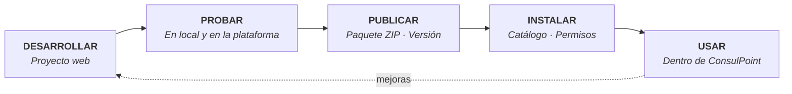

# Aplicaciones integradas

## Descripción

Una **aplicación integrada** es una aplicación web pequeña que se muestra dentro de ConsulPoint y trabaja con los datos de la organización: documentos, contactos, conversaciones o registros propios. Resuelve una tarea concreta con una pantalla hecha a medida, por ejemplo revisar pedidos recibidos por correo o gestionar solicitudes.

En [Conversaciones](/modulos/conversaciones) la persona habla con un agente. En una aplicación integrada trabaja con una pantalla diseñada para una tarea concreta, y lo que la plataforma ya resolvió, como la extracción de datos de un documento o el análisis de una conversación, le llega como información lista para usar.

**La aplicación aporta la experiencia de usuario; ConsulPoint aporta los datos, los permisos y el control.**

Esta sección explica cómo funcionan, cómo se desarrollan y cómo llegan a los usuarios.

:::info Otros nombres
En la API y en el código, una aplicación integrada se llama **mini app**. Son lo mismo.
:::

## Por dónde empezar

| Perfil | Qué necesita | Páginas |
|---|---|---|
| **Quien decide o administra** | Entender qué son, instalarlas y controlar qué pueden hacer | [Cómo funcionan](/aplicaciones-integradas/como-funcionan) · [Dónde aparecen](/aplicaciones-integradas/donde-aparecen) · [Instalar y administrar](/aplicaciones-integradas/instalar-y-administrar) |
| **Quien desarrolla** | Construir una aplicación, probarla y publicarla | [Tu primera aplicación](/aplicaciones-integradas/desarrollar/primera-aplicacion) y el resto de **Desarrollar** · [Publicar](/aplicaciones-integradas/publicar) |
| **Quien da soporte** | Resolver un problema concreto | [Problemas frecuentes](/aplicaciones-integradas/problemas-frecuentes) · [Referencia](/aplicaciones-integradas/referencia) |

## El recorrido completo

1. **Desarrollar**: la aplicación es un proyecto web normal que, al compilarse, produce archivos estáticos.
2. **Probar**: primero en el equipo de quien desarrolla, con datos de prueba; después dentro de la plataforma.
3. **Publicar**: se sube un paquete ZIP con una versión.
4. **Instalar**: cada organización la incorpora desde el catálogo, o la crea como aplicación propia.
5. **Usar**: aparece en los lugares de la plataforma que correspondan a su tipo.

## Dos orígenes

| Origen | Quién la crea | Quién la mantiene |
|---|---|---|
| **Instalada** | Se publica en el [Catálogo de integraciones](/organizacion/catalogo-de-aplicaciones) y cada organización la instala | Quien la publicó: sus versiones, permisos y modelos de datos llegan con cada actualización |
| **Propia** | La organización, desde **Configuración → Aplicaciones** | La propia organización |

:::tip Antes de crear desde cero
Conviene revisar el [Catálogo de integraciones](/organizacion/catalogo-de-aplicaciones): es posible que ya exista una aplicación equivalente.
:::
