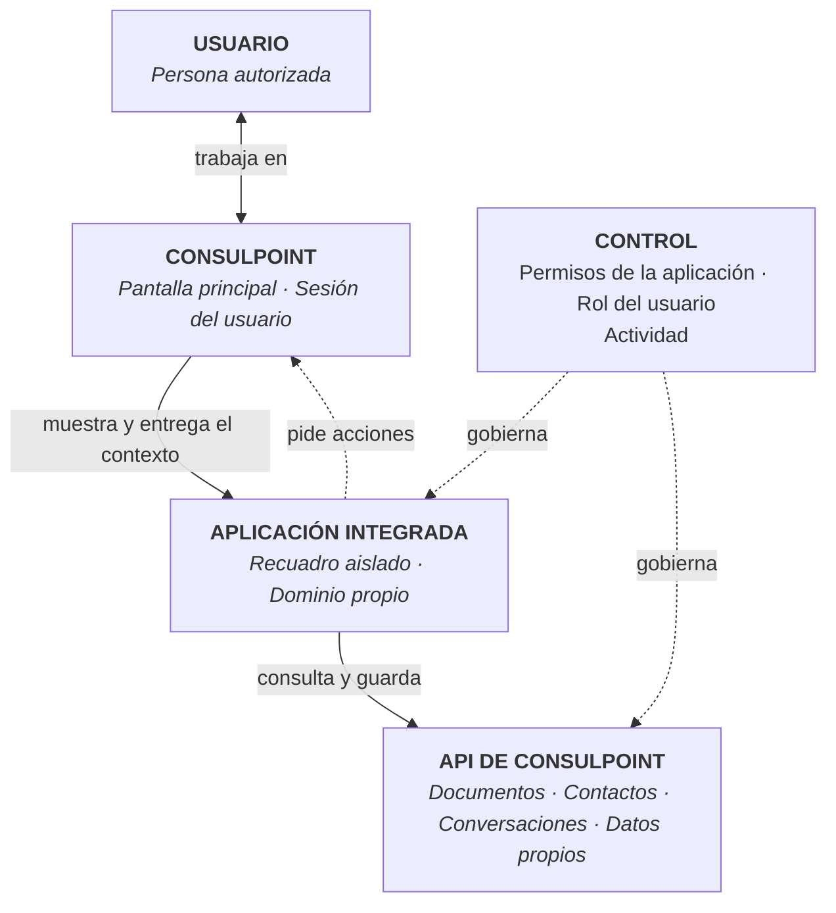

# Cómo funcionan

## Descripción

Una aplicación integrada se muestra dentro de ConsulPoint, pero se ejecuta **aislada** de la plataforma. Recibe solo lo necesario para trabajar y accede a los datos de la organización a través de la API, con los permisos que se le hayan concedido.

Esta página no requiere conocimientos de programación.

<Screenshot src="/img/aplicaciones-integradas/aplicacion-abierta.png" alt="Una aplicación integrada abierta dentro de ConsulPoint" caption="Una aplicación integrada de ejemplo, abierta dentro de ConsulPoint" />

## Arquitectura funcional



**ConsulPoint** muestra la aplicación en un recuadro dentro de su pantalla y le entrega el **contexto**: idioma, tema, una sesión temporal y los datos del lugar donde se abrió, como la carpeta o la conversación.

La **aplicación integrada** se carga desde un dominio distinto al de la plataforma. Por eso el navegador le impide leer la pantalla principal o la sesión del usuario.

La **API** es la única vía para leer o guardar datos de la organización. Cada petición lleva la sesión temporal de la aplicación.

La **capa de control** decide qué puede hacer: combina los permisos concedidos a la aplicación con el rol de la persona que la usa.

## La sesión de la aplicación

Al abrir una aplicación, la plataforma crea para ella una **sesión temporal**, distinta de la sesión del usuario.

| Característica | Valor |
|---|---|
| Duración | 30 minutos |
| Renovación | Automática, mientras la aplicación siga abierta |
| Alcance | Solo esa aplicación, esa organización y esa persona |
| Entrega | Después de cargar la aplicación; nunca en la dirección de la página |

## Qué puede hacer

- leer y guardar los datos para los que tenga permiso;
- guardar registros propios en sus [modelos de datos](/aplicaciones-integradas/desarrollar/datos-propios);
- pedir a la plataforma que actualice lo que muestra, abra una de sus páginas, abra un enlace externo o muestre un correo;
- registrar en la actividad quién hizo qué.

## Qué no puede hacer

- acceder a la sesión del usuario ni a la pantalla principal de ConsulPoint;
- usar datos para los que no tenga permiso, aunque la persona sí lo tenga;
- actuar por encima del rol de la persona que la usa, con la excepción de **Contactos**, donde basta el permiso de la aplicación;
- abrir ventanas o pestañas por su cuenta;
- funcionar fuera de ConsulPoint: abierta directamente en el navegador no recibe sesión.

De forma conceptual:

```text
Acceso de la aplicación =
Permisos de la aplicación
∩ Rol del usuario que la usa
```

:::warning Almacenamiento del navegador
El almacenamiento del navegador sirve solo para preferencias de interfaz. Los datos que deban conservarse o protegerse se guardan en la plataforma, no en el navegador.
:::
