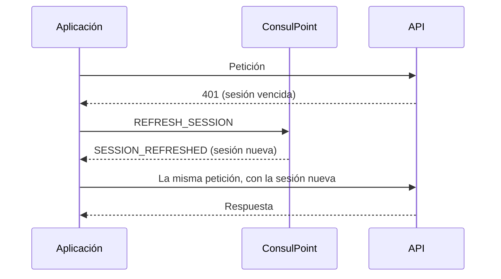

# Llamar a la API

## Descripción

La aplicación consulta y guarda datos de la organización a través de la API de ConsulPoint. Cada petición se identifica con la sesión temporal que recibió en el contexto.

## Cabeceras obligatorias

```text
Authorization: Bearer {token}
X-Mini-App-Id: {miniAppId}
```

La dirección se construye siempre a partir de `apiBaseUrl`. Conviene concentrar todas las peticiones en una sola función:

```ts title="src/services/api.ts"
import { getConfig } from '../config';

export async function sessionFetch(path: string, init: RequestInit = {}) {
  const { token, apiBaseUrl, miniAppId } = getConfig();
  return fetch(`${apiBaseUrl}${path}`, {
    ...init,
    headers: {
      Authorization: `Bearer ${token}`,
      'X-Mini-App-Id': miniAppId,
      ...(init.headers ?? {}),
    },
  });
}
```

## Renovar la sesión

La sesión dura **30 minutos**, pero la aplicación puede permanecer abierta mucho más. Cuando una petición responde `401`, la aplicación pide una sesión nueva a la plataforma y repite la petición una sola vez.



Reglas:

- Una respuesta `401` significa que el servidor no hizo nada, por lo que repetir la petición es seguro incluso al guardar.
- Varias peticiones vencidas a la vez comparten una única renovación.
- Si la plataforma responde `SESSION_REFRESH_FAILED`, o no responde en unos 8 segundos, se muestra un estado propio de **sesión expirada** que invite a abrir de nuevo la aplicación.
- La sesión nueva se conserva en memoria, nunca en el almacenamiento del navegador.

El formato de los mensajes está en [Comunicarse con la plataforma](/aplicaciones-integradas/desarrollar/comunicacion).

## Quién está usando la aplicación

Para atribuir acciones o mostrar el nombre de la persona, la identidad se consulta a la plataforma:

```text
GET {apiBaseUrl}/mini-apps/v2/{miniAppId}/session
```

```json
{ "userId": "…", "userName": "Ana García", "tenantId": "…", "miniAppId": "…" }
```

`userName` puede ser `null`. No debe obtenerse la identidad descifrando el token ni leyéndola de la dirección: esos valores pueden alterarse en el navegador.

## Permisos

Una aplicación solo accede a los recursos que tenga concedidos:

| Recurso | Operaciones posibles |
|---|---|
| **Centro de conocimiento** | Lectura · Creación · Actualización · Eliminación |
| **Bandeja inteligente** | Lectura · Creación · Actualización · Eliminación |
| **Conversaciones** | Lectura · Creación · Actualización · Eliminación |
| **Contactos** | Solo lectura |
| **Usuarios** | Solo lectura |

La aplicación actúa **en nombre de la persona que la usa**: además del permiso de la aplicación, esa persona necesita acceso al recurso por su rol. La excepción es **Contactos**, donde basta el permiso de la aplicación.

Sin permiso, la API responde `403`. Conviene tratarlo como «no disponible» y seguir funcionando con el resto, no como un error de pantalla completa.

Los permisos se conceden al [publicar](/aplicaciones-integradas/publicar) o al [administrar](/aplicaciones-integradas/instalar-y-administrar) la aplicación.

## Registrar actividad

La aplicación puede dejar constancia de quién hizo qué. La fecha y la persona las pone el servidor.

```text
POST {apiBaseUrl}/mini-app-runtime/activity
```

```json
{
  "recordId": "pedido-1042",
  "action": "ORDER_CONFIRMED",
  "changes": [{ "field": "estado", "before": "pendiente", "after": "confirmado" }]
}
```

La actividad de un registro se consulta con `GET /mini-app-runtime/activity?recordId=…`, y un administrador la revisa en la pestaña **Actividad** de la aplicación.

## Buenas prácticas

:::warning Frecuencia de las peticiones
La API limita el número de peticiones por intervalo. Ante una respuesta `429`, esperar y reintentar; evitar consultas en bucle.
:::
