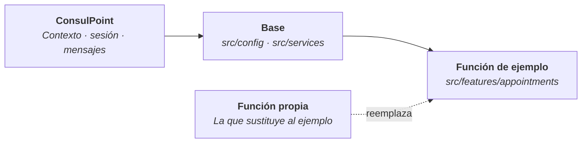

# Plantilla de inicio

La plantilla de inicio es un repositorio público con una aplicación integrada pequeña y completa: una **agenda de citas** que reserva una cita para un contacto, la confirma o la cancela y prepara el mensaje de confirmación para la conversación.

Sirve para ver cómo se integra una aplicación con ConsulPoint en código real, y como punto de partida para una aplicación propia: se conserva la base y se reemplaza la función de ejemplo.

**Repositorio:** [github.com/akui-solutions/consul-point-app-starter](https://github.com/akui-solutions/consul-point-app-starter)

<Screenshot src="/img/aplicaciones-integradas/plantilla-agenda.png" maxWidth={680} alt="Agenda de citas de la plantilla de inicio, con las citas próximas agrupadas por día" caption="La agenda de citas de la plantilla, en modo de demostración" />

**Requisitos:** Node.js 20 o superior y **yarn** o **pnpm**.

## Verla en local

No hace falta una cuenta. El modo de demostración funciona sin conexión, con datos inventados que se pierden al recargar la página.

```bash
git clone https://github.com/akui-solutions/consul-point-app-starter.git
cd consul-point-app-starter
yarn install
yarn dev:mock
```

La terminal indica la dirección en la que se abre. Para probar las variantes basta con agregar parámetros a esa dirección: `?theme=dark` o `?language=en`.

## Cómo se ve

Todas las capturas son del modo de demostración: las personas y las citas son inventadas.

<Screenshot src="/img/aplicaciones-integradas/plantilla-form.png" maxWidth={680} alt="Formulario Nueva cita de la plantilla, con dos contactos sugeridos al escribir" caption="Al reservar, la aplicación sugiere contactos de la organización" />

<Screenshot src="/img/aplicaciones-integradas/plantilla-menu.png" maxWidth={680} alt="Menú de acciones de una cita en la plantilla: insertar confirmación, ver contacto, agregar al calendario, editar, cancelar y eliminar" caption="Las acciones de cada cita, incluidas las que se piden a la plataforma" />

<Screenshot src="/img/aplicaciones-integradas/plantilla-panel.png" maxWidth={320} alt="Agenda de la plantilla en tema oscuro y con el ancho del panel lateral de una conversación" caption="La misma agenda en tema oscuro, con el ancho del panel lateral de una conversación" />

## Qué enseña

Cada función de la agenda corresponde a una parte de la integración.

| Lo que hace la aplicación | Qué enseña | Página relacionada |
|---|---|---|
| Se abre con el idioma y el tema del usuario | Leer el contexto que entrega la plataforma | [Contexto que recibe](/aplicaciones-integradas/desarrollar/contexto) |
| Registra quién reservó cada cita | Obtener la identidad verificada del usuario | [Llamar a la API](/aplicaciones-integradas/desarrollar/api-y-sesion) |
| Sigue funcionando pasada media hora | Renovar la sesión sin recargar | [Llamar a la API](/aplicaciones-integradas/desarrollar/api-y-sesion) |
| Guarda, edita y elimina citas | Mantener registros propios en un modelo de datos | [Datos propios](/aplicaciones-integradas/desarrollar/datos-propios) |
| Sugiere contactos al reservar | Leer datos de la organización con un permiso | [Referencia](/aplicaciones-integradas/referencia) |
| Reserva aunque no tenga ese permiso | Tratar la falta de permiso como función no disponible, no como error | [Problemas frecuentes](/aplicaciones-integradas/problemas-frecuentes) |
| Inserta la confirmación en el mensaje, abre la ficha del contacto y abre un enlace externo | Pedir acciones a la plataforma | [Comunicarse con la plataforma](/aplicaciones-integradas/desarrollar/comunicacion) |
| Funciona sin conexión con datos inventados | Trabajar la interfaz antes de tener un entorno | [Probar](/aplicaciones-integradas/desarrollar/probar) |

El archivo `README.md` del repositorio indica en qué archivo está cada una. Está escrito en inglés, igual que los comentarios del código; la aplicación funciona en español y en inglés.

## Crear una aplicación a partir de la plantilla



La base se conserva tal cual; lo que cambia es la función.

1. En la página del repositorio, pulsar **Use this template** y crear un repositorio nuevo. Recibe los archivos, no el historial, y puede ser privado.
2. Cambiar el nombre `consul-point-app-starter` en `package.json`, el identificador por defecto en `src/config/index.ts` y el título en `index.html`.
3. Reemplazar la carpeta `src/features/appointments/` por la función propia, conservando su forma: tipos, textos, lógica y pantalla por separado.
4. Definir los modelos de datos en `MODELS.md` y sustituir los datos inventados de `src/services/`.
5. Ajustar el color de acento en `src/styles/tokens.css`.

La carpeta `src/services/` y `src/config/` contienen la comunicación con la plataforma y no necesitan cambios para empezar.

## Publicarla en ConsulPoint

1. Ejecutar `yarn package`. Genera un archivo ZIP con `index.html` en la raíz.
2. Crear la aplicación con el tipo **Extensión** y subir el ZIP como su primera versión.
3. En la pestaña **Modelos**, crear el modelo `appointment` con el esquema del archivo `MODELS.md`.
4. En la pestaña **Permisos**, conceder lectura sobre **Contactos**. Es opcional: sin ese permiso el nombre de la persona se escribe a mano.

El detalle de cada paso está en [Publicar](/aplicaciones-integradas/publicar).

## Qué trae además del ejemplo

| Incluye | Para qué |
|---|---|
| Pruebas de la comunicación con la plataforma | Detectar un cambio que rompa la integración antes de publicarlo |
| Pruebas de la función de ejemplo | Servir de modelo para las de la aplicación propia |
| Revisión de código y de formato | Mantener el estilo al crecer el proyecto |
| Flujo de integración continua | Ejecutar revisión, pruebas y compilación en cada cambio propuesto |

## Buenas prácticas

:::tip Conservar la base
Conviene cambiar primero la función de ejemplo y dejar para después la carpeta `src/services/`: sus pruebas fijan cómo se habla con la plataforma.
:::

:::info Licencia
La plantilla se publica con licencia MIT: se puede copiar, modificar y usar en proyectos propios.
:::
