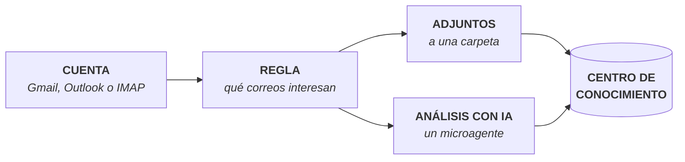

# Bandeja Inteligente

**Ruta:** `/smart-inbox`
**Permiso requerido:** el que corresponda sobre **Bandeja Inteligente**. Con los roles predeterminados, solo administradores

## Descripción

La Bandeja Inteligente muestra el correo de las cuentas conectadas (Gmail, Outlook o cualquier cuenta IMAP) dentro de ConsulPoint. Con **reglas de correo**, separa los correos que interesan, guarda sus adjuntos en el [Centro de Conocimiento](/modulos/centro-de-conocimiento) y los analiza con IA para obtener un resumen, los datos importantes y las acciones pendientes.

Esta sección no requiere conocimientos de programación.

<Screenshot src="/img/bandeja-inteligente/bandeja-inteligente.png" alt="Pantalla de la Bandeja Inteligente en ConsulPoint" caption="Bandeja Inteligente" />

:::info Correo, no mensajería
La Bandeja Inteligente trabaja con **correo electrónico**. Las conversaciones de WhatsApp o Telegram se gestionan desde [Conversaciones](/modulos/conversaciones). Tampoco envía ni responde correos: eso se sigue haciendo desde el programa de correo habitual.
:::

## Cómo funciona

1. **Se conecta una cuenta de correo** en Configuración. Ver [Conectar una cuenta](/bandeja-inteligente/conectar-una-cuenta).
2. **Se crea una regla** que dice qué correos interesan (por remitente, dominio o palabras del asunto) y qué hacer con ellos. Ver [Reglas de correo](/bandeja-inteligente/reglas-de-correo).
3. **Los adjuntos** de esos correos se guardan en una carpeta del Centro de Conocimiento.
4. **Un microagente** analiza cada correo y genera un resumen, que también puede guardarse en una carpeta. Ver [Análisis con IA](/bandeja-inteligente/analisis-con-ia).

Una vez en el Centro de Conocimiento, esos documentos se pueden [compartir con agentes](/centro-de-conocimiento/conocimiento-de-los-agentes) para que respondan con ellos.

:::warning Nada se procesa solo
Guardar los adjuntos y analizar los correos se pone en marcha desde la plataforma, correo a correo o por lotes (**Procesar adjuntos**, **Analizar pendientes**). La Bandeja Inteligente no revisa el buzón por su cuenta en segundo plano.
:::

## Dónde está

En la barra superior, el icono de bandeja abre la Bandeja Inteligente. Solo aparece para quien tiene permiso sobre ella.

Las reglas se gestionan en **Configuración → Reglas de correo**, y las cuentas de correo en **Configuración → Conectores**.

La Bandeja Inteligente no está disponible dentro de un [espacio de trabajo](/modulos/espacios-de-trabajo): se usa desde la organización principal.

## Por dónde empezar

| Quiero… | Página |
|---|---|
| Conectar mi cuenta de correo | [Conectar una cuenta](/bandeja-inteligente/conectar-una-cuenta) |
| Buscar y leer correos en la plataforma | [Leer el correo](/bandeja-inteligente/leer-el-correo) |
| Guardar automáticamente adjuntos de ciertos remitentes | [Reglas de correo](/bandeja-inteligente/reglas-de-correo) |
| Obtener resúmenes y datos de los correos | [Análisis con IA](/bandeja-inteligente/analisis-con-ia) |
| Resolver un problema | [Problemas frecuentes](/bandeja-inteligente/problemas-frecuentes) |
