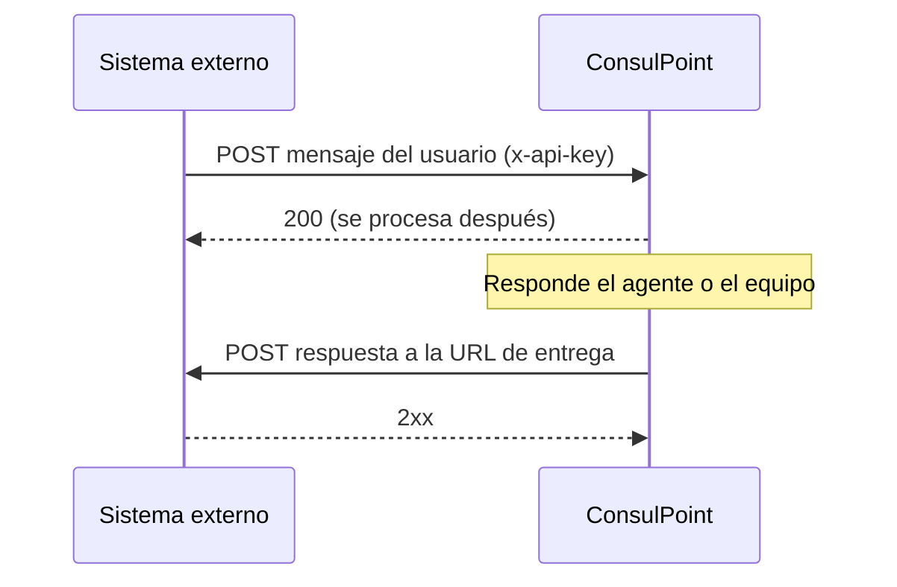

# API del canal de aplicación externa

Esta página es para quien desarrolla el sistema que se conecta a ConsulPoint como [aplicación externa](/organizacion/canales/aplicacion-externa): una app o una web propia cuyos usuarios conversan con un agente o con el equipo de la organización.

El intercambio tiene dos sentidos:



## Lo que se necesita

Un administrador de la organización crea el canal y entrega:

| Dato | Para qué |
|---|---|
| **Identificador del canal** (`integrationId`) | Va en la ruta de cada petición. Por ahora se pide a soporte de ConsulPoint |
| **API key** | Autentica cada petición, en la cabecera `x-api-key` |
| **Secreto de firma** | Firma los mensajes que se envían (si la firma es obligatoria) y permite comprobar la firma de las respuestas |
| **Dirección de la API** | La misma que usa la plataforma; la indica soporte junto con el identificador |

Y el sistema externo aporta su **URL de entrega** (HTTPS, en un dominio público, sin redirecciones) y una **API Key de entrega**, que el administrador configura en el canal.

Las rutas de esta página son relativas a la dirección de la API.

## Enviar un mensaje

```
POST /webhooks/external-app/inbound/{integrationId}
```

| Cabecera | Obligatoria | Contenido |
|---|---|---|
| `x-api-key` | Sí | La API key del canal |
| `Content-Type` | Sí | `application/json` |
| `x-signature` | Solo con firma obligatoria | Firma del cuerpo (ver [Firma](#firma)) |
| `x-signature-timestamp` | Solo con firma obligatoria | Momento del envío, en segundos Unix |

```json
{
  "externalUserId": "usuario-1234",
  "user": {
    "displayName": "Ana López",
    "language": "es",
    "metadata": { "plan": "premium", "appVersion": "4.3.2" }
  },
  "message": {
    "externalMessageId": "msg-0001",
    "role": "user",
    "content": "¿Cuál es el horario de atención del sábado?",
    "sentAt": "2026-11-12T10:15:00Z",
    "attachments": [],
    "metadata": { "pantalla": "ayuda" }
  }
}
```

| Campo | Obligatorio | Qué es |
|---|---|---|
| `externalUserId` | Sí | El identificador del usuario en el sistema externo. Siempre el mismo para la misma persona: agrupa sus mensajes en una conversación |
| `user.displayName` | No | Nombre que se muestra en el panel |
| `user.language` | No | Idioma del usuario, en formato ISO 639-1 (`es`, `en`, `pt`…). Basta con enviarlo una vez. Las respuestas se le entregan traducidas a ese idioma |
| `user.metadata` | No | Cualquier dato del usuario, en el formato que se quiera. Se guarda tal cual |
| `message.externalMessageId` | Sí | Identificador único del mensaje en el sistema externo. Ver [Mensajes repetidos](#mensajes-repetidos) |
| `message.role` | Sí | `user` para un mensaje del usuario; `assistant` para una respuesta generada por una IA propia del sistema externo (se guarda como contexto, pero no hace responder al agente) |
| `message.content` | Sí, salvo que haya adjuntos | El texto |
| `message.attachments` | No | Hasta 5 adjuntos. Ver [Adjuntos](#adjuntos) |
| `message.sentAt` | No | Momento real del mensaje, en ISO 8601 |
| `message.metadata` | No | Datos propios de este mensaje, por ejemplo una ubicación. Se guarda tal cual |

### Respuestas

| Código | Significado |
|---|---|
| `200` | Aceptado. Se procesa después: no significa que ya se vea en el panel |
| `401` | Firma ausente, caducada o incorrecta (con firma obligatoria) |
| `403` | API key ausente o incorrecta |
| `429` | Más de 120 peticiones por minuto en el canal |

### Mensajes repetidos

Si se envía dos veces el mismo `externalMessageId` (por ejemplo, al reintentar tras un error de red), el segundo envío se ignora sin error. Por eso el identificador tiene que ser único por mensaje: si se reutiliza para un mensaje distinto, ese mensaje se descarta.

### Adjuntos

Los adjuntos no viajan en el JSON: se envía una URL HTTPS pública desde la que ConsulPoint los descarga.

```json
{ "kind": "audio", "url": "https://cdn.example.com/media/nota-559.ogg", "mimeType": "audio/ogg", "filename": "nota.ogg" }
```

- Tipos: imágenes `image/jpeg`, `image/png`, `image/webp`; audios `audio/ogg`, `audio/mpeg`, `audio/mp4`.
- Hasta 16 MB por adjunto y 5 por mensaje. La URL tiene que seguir siendo válida unos minutos y no puede redirigir.
- Un adjunto que no se puede descargar se descarta, y el resto del mensaje se procesa igual.
- Si el canal tiene un agente, transcribe las notas de voz (consume créditos según su duración) y tiene en cuenta las imágenes.

### Conversaciones

Los mensajes del mismo `externalUserId` forman una conversación mientras no pase el **tiempo sin actividad** configurado en el canal (30 minutos por defecto). Pasado ese tiempo, el siguiente mensaje abre una conversación nueva. Si la conversación anterior estaba resuelta, un mensaje nuevo la reabre.

## Recibir las respuestas

Cada vez que el agente o el equipo responde, ConsulPoint hace un `POST` a la URL de entrega, con la **API Key de entrega** en `x-api-key` y la firma en `x-signature` y `x-signature-timestamp`:

```json
{
  "externalUserId": "usuario-1234",
  "message": {
    "messageId": "clx0abc123",
    "content": "Los sábados atendemos de 9:00 a 14:00.",
    "originalContent": "Los sábados atendemos de 9:00 a 14:00.",
    "language": "es",
    "sentAt": "2026-11-12T10:15:08Z",
    "attachments": [
      {
        "kind": "image",
        "url": "https://…",
        "mimeType": "image/jpeg",
        "filename": "horario.jpg",
        "expiresAt": "2026-11-12T11:15:08Z"
      }
    ]
  }
}
```

| Campo | Qué es |
|---|---|
| `externalUserId` | El usuario al que hay que entregar la respuesta |
| `message.messageId` | Identificador de la respuesta. Usarlo para no entregar dos veces la misma |
| `message.content` | El texto, ya traducido al idioma del usuario. Puede venir vacío si solo hay adjuntos |
| `message.originalContent` | El texto original, solo si se tradujo |
| `message.language` | Idioma de `content` |
| `message.attachments` | Adjuntos (`image`, `video`, `audio` o `file`), cada uno con una URL temporal que caduca en **1 hora**. Descargarlos al recibir la entrega |

La URL de entrega tiene que responder con un código `2xx`. Si falla, ConsulPoint reintenta hasta **5 veces**, con esperas crecientes desde 30 segundos; cada reintento llega con el mismo `messageId`. Después de eso, la entrega queda registrada como fallida.

## Firma

Cuando la firma es obligatoria, cada mensaje enviado lleva una firma; y todas las respuestas que entrega ConsulPoint la llevan, para que el sistema externo pueda comprobar que vienen de ConsulPoint.

```
x-signature = hex( HMAC_SHA256( secretoDeFirma, "{timestamp}.{cuerpo}" ) )
```

- `{timestamp}` es el valor de `x-signature-timestamp`, en segundos Unix.
- `{cuerpo}` son los **bytes exactos** del cuerpo de la petición. Al firmar, serializar el JSON una sola vez y enviar esos mismos bytes; al comprobar, usar el cuerpo tal como llega, antes de convertirlo en objeto.
- Se rechaza una firma con más de **5 minutos** de diferencia con la hora actual.

Ejemplo de comprobación en Node.js:

```js
const crypto = require('crypto');

function firmaValida(cuerpoCrudo, cabeceras, secreto) {
  const timestamp = cabeceras['x-signature-timestamp'];
  if (Math.abs(Date.now() / 1000 - Number(timestamp)) > 300) return false;
  const esperada = crypto
    .createHmac('sha256', secreto)
    .update(`${timestamp}.${cuerpoCrudo}`)
    .digest('hex');
  const recibida = cabeceras['x-signature'] ?? '';
  return (
    esperada.length === recibida.length &&
    crypto.timingSafeEqual(Buffer.from(esperada), Buffer.from(recibida))
  );
}
```

## Consultar el histórico

```
GET /webhooks/external-app/{integrationId}/messages?externalUserId={id}&limit=50&cursor={cursor}
```

Con la misma API key (y la firma, si es obligatoria; en ese caso se firma la ruta con sus parámetros). Devuelve todos los mensajes del usuario, de todas sus conversaciones, del más antiguo al más reciente:

```json
{
  "externalUserId": "usuario-1234",
  "messages": [
    { "id": "clx0abc120", "role": "user", "content": "¿Cuál es el horario…?", "language": "es", "sentAt": "…", "externalMessageId": "msg-0001" },
    { "id": "clx0abc123", "role": "assistant", "content": "Los sábados…", "language": "es", "sentAt": "…", "externalMessageId": null }
  ],
  "nextCursor": "MjAyNi0xMS0xMl…"
}
```

- `limit`: hasta 100 por página (50 por defecto).
- Seguir pidiendo páginas con `nextCursor` hasta que sea `null`. Una página puede traer menos mensajes que `limit`, o ninguno, y aun así tener `nextCursor`.
- No incluye los adjuntos ni los mensajes automáticos de espera.
- Límite: 60 peticiones por minuto.

## Antes de salir a producción

- [ ] La API key y el secreto de firma se guardan como contraseñas, nunca en el código ni en registros.
- [ ] Cada mensaje lleva un `externalMessageId` único.
- [ ] La URL de entrega es HTTPS, pública, sin redirecciones, y responde `2xx`.
- [ ] La entrega no duplica respuestas con el mismo `messageId`.
- [ ] Los adjuntos de las respuestas se descargan al recibirlos.
- [ ] Si el canal tiene un agente asignado, la IA propia del sistema externo está apagada, para que el usuario no reciba dos respuestas.
