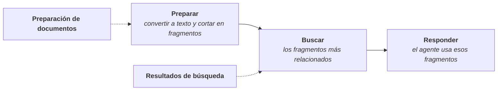

# Búsqueda de los agentes

<PageMeta route="/knowledge-hub">editar sobre **Centro de conocimiento** y poder editar la carpeta</PageMeta>

Cuando un agente responde con los documentos de una carpeta, primero **busca** en ellos los fragmentos relacionados con la pregunta y después responde a partir de esos fragmentos. La **búsqueda de los agentes** permite ajustar ese proceso en cada carpeta: cómo se preparan sus documentos y qué información recibe el agente en cada búsqueda.

La configuración de la plataforma funciona bien para la mayoría de los casos. Conviene ajustarla cuando las respuestas no encuentran lo que está en los documentos: fichas muy parecidas entre sí, manuales con procedimientos largos, tablas complejas o planos con información en imágenes.

**Casos de uso:** una carpeta de fichas de productos en la que el agente confunde unas con otras; una carpeta de normativas en la que los procedimientos llegan cortados; un sector con siglas propias que el agente no reconoce.

## Cómo busca un agente

1. **Preparar.** Cuando un documento llega a una carpeta compartida con un agente, la plataforma lo convierte a texto y lo corta en **fragmentos**: trozos de texto de un tamaño parecido. Cada fragmento se guarda de forma que se pueda buscar por significado, no solo por palabras exactas.
2. **Buscar.** En cada pregunta, un **agente de búsqueda** busca los fragmentos más relacionados en las carpetas a las que tiene acceso el agente.
3. **Responder.** El agente redacta la respuesta con esos fragmentos. No lee los documentos completos.

Los ajustes se reparten en dos grupos, uno para cada momento:

| Grupo | Qué ajusta | Cuándo se nota un cambio |
|---|---|---|
| **Preparación de documentos** | Cómo se cortan los documentos y cómo se leen sus tablas e imágenes | En los documentos que se preparen después. Los que ya estaban siguen como antes hasta que se **actualizan**. Ver [Actualizar los documentos](/centro-de-conocimiento/actualizar-los-documentos) |
| **Resultados de búsqueda** | Cuántos fragmentos recibe el agente y qué agente de búsqueda usa | Desde el siguiente mensaje, sin tener que actualizar nada |

## A qué carpetas se aplica

La configuración se define en la **carpeta que se comparte con el agente** (o la carpeta propia de un agente) y vale para ella y para todas sus subcarpetas. Si dentro hay otra carpeta compartida con un agente por separado, esa usa su propia configuración.

Por eso la opción solo aparece en las carpetas compartidas con algún agente. Las carpetas [multimedia](/centro-de-conocimiento/multimedia) no la tienen.

## Abrir la configuración

<Screenshot src="/img/centro-de-conocimiento/busqueda-menu.png" alt="Menú de una carpeta del Centro de Conocimiento con la opción Configurar búsqueda de agentes" caption="Menú de una carpeta compartida con un agente" maxWidth={520} />

La ventana **Búsqueda de los agentes** se abre desde varios lugares:

- En el menú **⋯** de la carpeta, o en el menú del título dentro de ella: **Configurar búsqueda de agentes**.
- En **Editar carpeta**, dentro de **Opciones avanzadas**: la fila **Búsqueda de los agentes**, que indica la configuración en uso y cuántos documentos están pendientes de actualizar.
- En la información de la carpeta (**Ver detalles**), con **Revisar y actualizar**, cuando hay documentos pendientes.
- Pulsando la marca naranja de documentos pendientes junto al nombre de la carpeta.

Hace falta permiso de editar sobre el **Centro de conocimiento** y poder editar la carpeta: ser quien la creó, o tener **Puede editar** o **Puede administrar** si está compartida. Quien solo puede verla consulta la configuración en la información de la carpeta.

## Origen de la configuración

Lo primero de la ventana es de dónde salen los ajustes:

| Origen | Qué significa | Cuándo elegirlo |
|---|---|---|
| **Predeterminada** | La configuración general de la plataforma. Se muestra para consultarla, sin poder cambiarla | Para la mayoría de las carpetas |
| **Perfil** | Una configuración con nombre que comparten varias carpetas. Se elige en **Perfil de búsqueda** y sus valores se muestran para consultarlos | Cuando varias carpetas tienen el mismo tipo de documentos. Ver [Perfiles de búsqueda](/centro-de-conocimiento/perfiles-de-busqueda) |
| **Propia** | Ajustes exclusivos de esta carpeta, editables | Para una carpeta con necesidades particulares, o para preparar un perfil nuevo |

Un perfil se aplica entero: no se puede cambiar un solo ajuste para una carpeta. Para eso, **Usar como configuración propia** copia los valores del perfil a la carpeta, que pasa a **Propia** y se puede ajustar.

Si todavía no hay perfiles, la opción **Perfil** aparece desactivada.

## Preparación de documentos

<Screenshot src="/img/centro-de-conocimiento/busqueda-preparacion.png" alt="Grupo Preparación de documentos en la ventana Búsqueda de los agentes" caption="Búsqueda de los agentes → Propia → Preparación de documentos" maxWidth={480} />

Configura cómo se preparan los documentos de la carpeta.

:::warning Los cambios no se aplican solos
Los documentos que ya estaban preparados siguen con la configuración anterior hasta que se actualizan. Al guardar un cambio en este grupo, la plataforma muestra a cuántos documentos afecta y ofrece actualizarlos. Ver [Actualizar los documentos](/centro-de-conocimiento/actualizar-los-documentos).
:::

### Tipo de contenido

El tamaño de los fragmentos en que se cortan los documentos. Se elige el que más se parezca a los documentos de la carpeta:

| Opción | Para | Qué hace |
|---|---|---|
| **General (recomendado)** | La mayoría de los documentos | Fragmentos medianos. Es la opción predeterminada |
| **Fichas o registros cortos** | Muchos documentos breves: fichas, preguntas frecuentes, catálogos, directorios | Fragmentos pequeños, para que cada ficha quede en su propio fragmento y no se mezcle con la siguiente |
| **Documentos largos** | Manuales, contratos, normativas e informes extensos | Fragmentos grandes, para que un procedimiento largo llegue entero |
| **Personalizado** | Casos que no encajan en los anteriores | Se definen los tamaños a mano |

Detalle técnico: los tamaños se miden en **tokens**, la unidad con la que los modelos cuentan el texto (100 tokens son unas 75 palabras).

| Opción | Tamaño de cada fragmento | Texto repetido entre fragmentos | Se unen los fragmentos más cortos que |
|---|---|---|---|
| **General** | 1.000 | 100 | 200 |
| **Fichas o registros cortos** | 400 | 0 | 80 |
| **Documentos largos** | 1.500 | 150 | 500 |

Con **Personalizado** aparecen los tres valores, a partir de la opción que estaba elegida:

| Campo | Qué hace | Valores |
|---|---|---|
| **Tamaño de cada fragmento** | El tamaño máximo de cada fragmento | De 200 a 1.800 tokens |
| **Texto repetido entre fragmentos** | El final de un fragmento se repite al principio del siguiente, para que una idea no quede cortada | De 0 a la cuarta parte del tamaño |
| **Unir los fragmentos más cortos que** | Las secciones muy cortas se unen a la siguiente hasta llegar a este tamaño | De 50 al tamaño del fragmento |

### Lectura de tablas

| Opción | Qué hace |
|---|---|
| **Rápida** | Más rápida. Puede perder detalle en tablas complejas o con celdas combinadas. Es la opción predeterminada |
| **Precisa** | Más lenta. Lee bien las tablas complejas o con celdas combinadas |

Se aplica a los documentos que no son PDF y a los PDF que se convierten con el servicio **Esencial** (ver [Conversión de PDF](/centro-de-conocimiento/carpetas-y-archivos#conversión-de-pdf)).

### Imágenes de los PDF

| Ajuste | Qué hace |
|---|---|
| **Describir las imágenes de los PDF** | La plataforma describe con IA los gráficos, fotos y diagramas, para que los agentes encuentren lo que muestran |
| **Descartar imágenes decorativas** | Los logos, íconos y adornos no se describen. Solo con la anterior activada |
| **Largo máximo de cada descripción (caracteres)** | De 100 a 1.000. Conviene subirlo si las imágenes tienen datos, como gráficos o tablas guardadas como imagen |

Solo está disponible si la carpeta convierte los PDF con el servicio **Avanzado** y **Conservar las imágenes**. Si no, la ventana lo indica y ofrece **Cambiar la conversión de PDF**, que abre **Editar carpeta**.

### Opciones avanzadas

| Ajuste | Qué hace | Cuándo activarlo |
|---|---|---|
| **Incluir el título de la sección en cada fragmento** | Cada fragmento se busca también por el nombre del documento y los títulos de su sección | Fichas muy parecidas entre sí: así "de 9 a 18 h" queda ligado a "Museo X > Horarios" |
| **Repetir el encabezado de las tablas en cada fragmento** | Si una tabla larga se corta en varios fragmentos, cada uno repite la fila de títulos | Documentos con tablas largas |

## Resultados de búsqueda

<Screenshot src="/img/centro-de-conocimiento/busqueda-resultados.png" alt="Grupo Resultados de búsqueda en la ventana Búsqueda de los agentes" caption="Búsqueda de los agentes → Propia → Resultados de búsqueda" maxWidth={480} />

Configura qué información recibe el agente en cada búsqueda. Los cambios se aplican desde el siguiente mensaje.

| Ajuste | Qué hace | Valores | Predeterminado |
|---|---|---|---|
| **Fragmentos predeterminados** | Cuántos fragmentos recibe el agente en cada búsqueda, salvo que pida otra cantidad | De 1 al **Límite de fragmentos** | 8 |
| **Agente de búsqueda** | El agente que busca en los documentos. Ver más abajo | Los agentes de búsqueda activos | **Agente predeterminado** |

En **Opciones avanzadas**:

| Ajuste | Qué hace | Valores | Predeterminado |
|---|---|---|---|
| **Límite de fragmentos** | El máximo que puede recibir si pide más resultados | De 1 a 30 | 20 |
| **Fragmentos vecinos** | Con cada fragmento encontrado llegan también los que lo rodean en el mismo documento. Con 2, los 2 anteriores y los 2 posteriores | De 0 a 2 | 0 |
| **Máximo de fragmentos por documento** | Cuántos fragmentos puede aportar un mismo documento a los resultados | De 1 al **Límite de fragmentos**, o **Sin límite** | **Sin límite** |

Más fragmentos dan más contexto al agente, pero cada respuesta consume más [créditos](/organizacion/creditos-y-limites). Algunas guías:

- **Procedimientos que llegan cortados**: subir **Fragmentos vecinos** a 1.
- **Un documento muy largo acapara los resultados**: fijar un **Máximo de fragmentos por documento**, para dejar sitio a otros documentos.
- **Muchas fichas parecidas y el agente no encuentra la correcta**: subir **Fragmentos predeterminados**.

### Agente de búsqueda

El agente de búsqueda es quien busca en los documentos y elige los fragmentos. El **Agente predeterminado** de la plataforma sirve para la mayoría de los casos.

Un agente de búsqueda propio añade los **criterios y la terminología** de la organización: qué es relevante, sinónimos y siglas. Por ejemplo: "en contratos, *adenda* y *modificación* son lo mismo; prioriza siempre la versión vigente". Se crea en el Estudio como un microagente de tipo **Agente de búsqueda** y se asigna a carpetas, no a agentes. Ver [Microagentes](/control/estudio/microagentes#agente-de-búsqueda).

Si el agente de búsqueda elegido deja de estar disponible (se desactiva o su modelo ya no está en la suscripción), los agentes siguen respondiendo con el **Agente predeterminado**.

## Guardar

**Guardar cambios** guarda la configuración. Solo cambia la búsqueda de la carpeta; el resto de la carpeta queda igual.

- Si el cambio es solo de **Resultados de búsqueda** o del agente de búsqueda, se guarda directamente: **Búsqueda guardada**.
- Si el cambio afecta a la **Preparación de documentos**, o cambia el origen o el perfil, antes aparece **Revisar el cambio**, con los documentos afectados. Ver [Actualizar los documentos](/centro-de-conocimiento/actualizar-los-documentos).

Al cerrar con cambios sin guardar, la ventana pregunta si descartarlos.

## Dónde se ve la configuración de una carpeta

<Screenshot src="/img/centro-de-conocimiento/carpeta-informacion.png" alt="Información de una carpeta con la sección Procesamiento y búsqueda" caption="Información de la carpeta → Procesamiento y búsqueda" maxWidth={720} />

- **En la lista de carpetas**, una marca junto al nombre:

  <Screenshot src="/img/centro-de-conocimiento/busqueda-marcas-carpetas.png" alt="Lista del Centro de Conocimiento con las marcas de búsqueda de cada carpeta" caption="Marcas de búsqueda en la lista de carpetas" maxWidth={1166} />

  | Marca | Significa |
  |---|---|
  | Naranja, con flechas | Hay documentos pendientes de actualizar. Pulsarla abre la configuración |
  | Gris: **Esta carpeta usa un perfil de configuración** | Usa un perfil |
  | Gris: **Esta carpeta usa una configuración propia** | Usa una configuración propia |
  | Sin marca | Usa la configuración predeterminada |

- **En la información de la carpeta** (**Ver detalles**), sección **Procesamiento y búsqueda**: la **Configuración de búsqueda** (**Predeterminada**, **Propia** o el perfil), el **Agente de búsqueda** y, si los hay, los documentos pendientes de actualizar.

## Buenas prácticas

:::tip Cambiar una cosa cada vez
Conviene cambiar un ajuste, probar con las mismas preguntas en Conversaciones y comparar. Si se cambian varios a la vez, no se sabe cuál ayudó.
:::

:::tip Describir bien la carpeta
El agente de búsqueda lee la **Descripción** de la carpeta para decidir dónde buscar. Una descripción clara ("Fichas técnicas de los equipos de planta") mejora los resultados cuando el agente tiene varias carpetas.
:::

:::tip Un perfil por tipo de documentos
Si varias carpetas tienen el mismo tipo de documentos, un [perfil](/centro-de-conocimiento/perfiles-de-busqueda) evita repetir la configuración y la mantiene igual en todas.
:::
