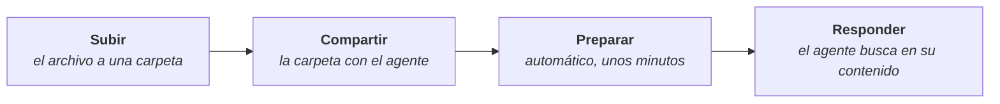

# Centro de Conocimiento

<PageMeta route="/knowledge-hub">el que corresponda sobre **Centro de Conocimiento**</PageMeta>

Repositorio de documentos de la organización, organizado en carpetas. Es la fuente de la que leen los agentes: un agente solo responde con el contenido de las carpetas que se comparten con él.

Esta sección no requiere conocimientos de programación.

<Screenshot src="/img/centro-de-conocimiento/centro-de-conocimiento.png" alt="Pantalla del Centro de Conocimiento en ConsulPoint" caption="Centro de Conocimiento" />

## Cómo llega un documento a un agente

1. **Subir** el archivo a una carpeta.
2. **Compartir** la carpeta con el agente. El orden de estos dos pasos da igual.
3. La plataforma **prepara** cada archivo para que el agente pueda leerlo: extrae el texto, lo divide en fragmentos y lo indexa para buscar por significado. Ocurre sola y tarda unos minutos.
4. Al conversar, el agente **busca** en ese contenido los fragmentos relacionados con cada pregunta y responde con ellos.

:::warning Subir no basta
Un archivo en una carpeta que no está compartida con ningún agente se guarda, pero ningún agente lo lee. Ver [Conocimiento de los agentes](/centro-de-conocimiento/conocimiento-de-los-agentes).
:::

## Las dos pestañas

| Pestaña | Contenido |
|---|---|
| **Mis documentos** | Las carpetas y archivos propios del usuario |
| **Compartidos conmigo** | Lo que otras personas comparten con el usuario |

**Mis documentos** solo aparece para roles con permiso de edición sobre Centro de Conocimiento. Con los roles predeterminados, los usuarios y colaboradores solo ven **Compartidos conmigo**. Dentro de un [espacio de trabajo](/modulos/espacios-de-trabajo) tampoco existe **Mis documentos**: el contenido llega compartido.

## Tipos de carpeta

Se elige al crear la carpeta y no se puede cambiar después.

| Tipo | Para qué sirve |
|---|---|
| **Estándar** | Cualquier tipo de documento. Es la opción habitual para dar conocimiento a los agentes |
| **Extracción inteligente** | Un agente extrae datos de cada documento que se sube y los guarda, por ejemplo de facturas o formularios. Ver [Extracción inteligente](/centro-de-conocimiento/extraccion-inteligente) |
| **Multimedia** | Vídeos y audios de YouTube, de los que se obtiene la transcripción. Ver [Multimedia](/centro-de-conocimiento/multimedia) |

## Por dónde empezar

| Quiero… | Página |
|---|---|
| Crear carpetas, buscar, mover o eliminar contenido | [Carpetas y archivos](/centro-de-conocimiento/carpetas-y-archivos) |
| Subir documentos y saber qué formatos se admiten | [Subir documentos](/centro-de-conocimiento/subir-documentos) |
| Que un agente responda con mis documentos | [Conocimiento de los agentes](/centro-de-conocimiento/conocimiento-de-los-agentes) |
| Dar acceso a otras personas o a un espacio de trabajo | [Compartir y permisos](/centro-de-conocimiento/compartir-y-permisos) |
| Sacar datos de facturas, albaranes o formularios | [Extracción inteligente](/centro-de-conocimiento/extraccion-inteligente) |
| Trabajar con vídeos o audios de YouTube | [Multimedia](/centro-de-conocimiento/multimedia) |
| Resolver un problema | [Problemas frecuentes](/centro-de-conocimiento/problemas-frecuentes) |

## Buenas prácticas

:::tip Organización documental
- Una carpeta por tema, en lugar de una carpeta única con todo. Permite compartir con cada agente solo lo que necesita.
- Empezar por la documentación más consultada: preguntas frecuentes, catálogos, políticas y manuales.
- Retirar la documentación obsoleta. Un agente reproduce un documento desactualizado con la misma seguridad que uno vigente.
:::
