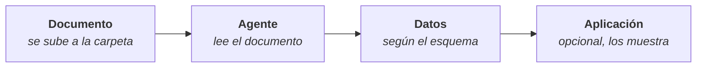

# Extracción inteligente

Una carpeta de tipo **Extracción inteligente** saca datos de cada documento que se sube a ella y los guarda de forma estructurada: por ejemplo, el proveedor, la fecha y el importe de cada factura. La extracción la hace un agente, siguiendo un esquema que define qué datos interesan.

**Casos de uso:** facturas, albaranes, pedidos, formularios y cualquier documentación recurrente de estructura estable.

## Antes de empezar

Hace falta, como mínimo, un **microagente de tipo OCR** creado en el Estudio: es el agente que lee los documentos. Ver [Microagentes](/control/estudio/microagentes).

Opcionalmente:

- Un **esquema de datos**, para fijar qué datos se extraen y comprobar que se cumplen. Ver [Esquemas de datos](/control/estudio/esquemas-de-datos).
- Una **aplicación integrada** de tipo visualizador, para ver los datos con un diseño propio. Ver [Aplicaciones integradas](/aplicaciones-integradas).

## Configurar la carpeta

1. Crear una carpeta y elegir el tipo **Extracción inteligente** (ver [Crear una carpeta](/centro-de-conocimiento/carpetas-y-archivos#crear-una-carpeta)).
2. En **Configuración de la extracción**, completar:

   | Campo | Descripción |
   |---|---|
   | **Agente** | Obligatorio. El microagente OCR que extrae los datos |
   | **Esquema de datos (opcional)** | Define qué datos se guardan de cada documento |
   | **Aplicación (opcional)** | Muestra una vista previa de los datos extraídos |

3. Pulsar **Crear carpeta**.

La configuración se puede cambiar después con **Editar carpeta**. La plataforma pide confirmación, porque afecta a los documentos que se suban a partir de ese momento.

Estas carpetas admiten PDF, imágenes PNG y JPG, y Markdown.

## Estados de la extracción

En la vista de lista, la columna **Extracción inteligente** muestra el estado de cada documento:

| Estado | Significado |
|---|---|
| **Pendiente** | En espera de extraer los datos |
| **Extrayendo datos** | En curso |
| **Datos extraídos** | Terminada |
| **Extraídos con avisos** | Terminada, pero los datos no cumplen el esquema de datos |
| **No se pudo extraer** | Falló. Se puede reintentar desde la vista previa del archivo |
| **Duplicado** | El archivo repite el contenido de otro de la carpeta ya extraído, así que no se volvió a extraer |

Cuando una extracción falla, al pasar el ratón por **No se pudo extraer**, y en la fila **Motivo** de la vista previa, se ve la causa:

| Causa | Qué hacer |
|---|---|
| El agente de extracción no tiene instrucciones | Añadírselas en su configuración y reintentar |
| El agente de extracción no está bien configurado | Revisar su tipo y su modelo, y reintentar |
| El plan no incluye el modelo de IA del agente | Elegir otro modelo o mejorar el plan |
| El archivo es demasiado largo | Probar con uno más corto |
| No se pudo identificar la causa | Reintentar y, si sigue fallando, contactar con soporte |

Quien no tiene permiso para extraer ve la causa con la indicación de pedir ayuda a un administrador.

## Ver y gestionar los datos

Al abrir un archivo, la sección **Extracción inteligente** muestra el estado, las fechas y el resultado, con **Ver los datos**. La vista previa tiene, además, la pestaña **Datos extraídos** y, si la carpeta tiene aplicación, **Vista de la app**.

| Acción | Qué hace |
|---|---|
| **Extraer datos** / **Reintentar** | Lanza la extracción si no se hizo o falló |
| **Volver a extraer** | Extrae de nuevo y sustituye los datos actuales. Consume créditos. La nota actual no pasa a la nueva extracción |
| **Notas** | Una nota libre sobre la extracción, de hasta 500 caracteres |
| **Eliminar extracción** | Borra los datos extraídos. El archivo no se ve afectado |

Estas acciones requieren ser el propietario del archivo o tener el nivel **Puede administrar** sobre la carpeta.

Si los datos no cumplen el esquema, la sección lo indica (**Los datos no cumplen el esquema**) y lista los problemas con **Ver problemas**. Conviene revisarlos antes de usar esos datos en otra aplicación.

## Buenas prácticas

:::tip Extracciones fiables
- Una carpeta por tipo de documento: facturas en una, albaranes en otra. Cada una con su agente y su esquema.
- Definir un esquema de datos. Sin él, la plataforma no puede avisar cuando falta un dato o tiene un formato incorrecto.
- Probar con pocos documentos reales antes de subir un lote grande, y ajustar las instrucciones del microagente si hace falta.
:::
