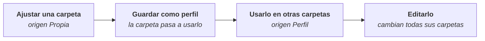

# Perfiles de búsqueda

<PageMeta route="/knowledge-hub">ver sobre **Centro de conocimiento** para consultarlos; crear para crearlos; solo quien creó un perfil lo edita o elimina</PageMeta>

Un **perfil de búsqueda** es una [configuración de búsqueda](/centro-de-conocimiento/busqueda-de-los-agentes) con nombre que comparten varias carpetas: la preparación de los documentos, los resultados de búsqueda y el agente de búsqueda. Al editar el perfil, cambian todas las carpetas que lo usan.

**Casos de uso:** un perfil "Fichas de producto" para todas las carpetas de catálogos; un perfil "Normativa" con fragmentos largos y un agente de búsqueda que conoce las siglas del sector.

## El recorrido de un perfil

Los perfiles no se crean en blanco: nacen de una carpeta que ya tiene una configuración probada.

## Crear un perfil

1. Abrir **Búsqueda de los agentes** en la carpeta (menú **⋯** → **Configurar búsqueda de agentes**).
2. Elegir el origen **Propia** y ajustar los valores. Conviene probarlos antes en Conversaciones.
3. Pulsar **Guardar como perfil**.
4. Completar la ventana:

   | Campo | Descripción |
   |---|---|
   | **Nombre del perfil** | Obligatorio, hasta 100 caracteres. No puede repetirse en el mismo espacio de trabajo. Por ejemplo: "Manuales técnicos" |
   | **Descripción (opcional)** | Hasta 500 caracteres. Para qué tipo de carpetas sirve |
   | **Disponible en todos los espacios de trabajo** | Si no se marca, el perfil solo se puede usar en el espacio de trabajo actual. Ver más abajo |

5. Pulsar **Crear perfil**.

<Screenshot src="/img/centro-de-conocimiento/perfil-guardar.png" alt="Ventana Guardar como perfil" caption="Guardar como perfil" maxWidth={560} />

La carpeta pasa a usar el perfil: **Perfil creado — La carpeta ya usa el perfil "…"**. Si los ajustes sin guardar afectan a la preparación de los documentos, antes aparece la revisión del cambio, con **Solo crear el perfil** o **Crear y aplicar ahora**. Ver [Actualizar los documentos](/centro-de-conocimiento/actualizar-los-documentos#revisar-el-cambio).

**Guardar como perfil** solo aparece a quien creó la carpeta y tiene permiso de crear sobre el **Centro de conocimiento**. Si algún ajuste tiene un error, el botón queda desactivado hasta corregirlo.

## Usar un perfil en una carpeta

1. Abrir **Búsqueda de los agentes** en la carpeta.
2. Elegir el origen **Perfil** y el perfil en **Perfil de búsqueda**. Debajo se ven sus valores y su descripción.
3. Pulsar **Guardar cambios**.

<Screenshot src="/img/centro-de-conocimiento/busqueda-perfil.png" alt="Ventana Búsqueda de los agentes con el origen Perfil elegido" caption="Búsqueda de los agentes → Perfil" maxWidth={480} />

Cambiar a un perfil cambia la preparación de los documentos, así que aparece la revisión del cambio. Ver [Actualizar los documentos](/centro-de-conocimiento/actualizar-los-documentos).

Un perfil se aplica entero. Para ajustar un valor solo en una carpeta, **Usar como configuración propia** copia los valores del perfil a la carpeta, que pasa a **Propia** y deja de recibir los cambios del perfil.

## La ventana Perfiles de búsqueda

<Screenshot src="/img/centro-de-conocimiento/perfiles-lista.png" alt="Ventana Perfiles de búsqueda con la lista de perfiles" caption="Perfiles de búsqueda" maxWidth={600} />

Se abre con el botón **Perfiles de búsqueda** de la página principal del Centro de Conocimiento, o con **Gestionar perfiles** desde la ventana de búsqueda de una carpeta.

Cada perfil muestra su nombre, su descripción y:

| Indicación | Significa |
|---|---|
| **Tuyo** | Lo creó quien mira la pantalla |
| **En todos los espacios de trabajo** / **Solo en este espacio de trabajo** | Dónde se puede usar |
| **Utilizado por … carpetas** / **Ninguna carpeta lo utiliza** | Cuántas carpetas lo usan |

Al pulsar un perfil se abre su detalle, con todos sus valores. Quien lo creó ve además **Carpetas que lo usan**, con **Abrir** para ir a la configuración de cada una, y los botones **Editar** y **Eliminar**.

<Screenshot src="/img/centro-de-conocimiento/perfil-detalle.png" alt="Detalle de un perfil de búsqueda con sus valores y las carpetas que lo usan" caption="Detalle de un perfil" maxWidth={480} />

## Editar un perfil

Solo quien creó el perfil puede editarlo.

1. En el detalle del perfil, pulsar **Editar**.
2. Cambiar el nombre, la descripción, la disponibilidad en los espacios de trabajo o los **Ajustes**, que son los mismos de la configuración **Propia**, incluido el agente de búsqueda.
3. Pulsar **Guardar cambios**.

Si hay carpetas que usan el perfil, la ventana lo recuerda antes de guardar. Al guardar, **todas esas carpetas** reciben los cambios:

- Los cambios en **Resultados de búsqueda** y en el agente de búsqueda rigen desde el siguiente mensaje.
- Los cambios en la **Preparación de documentos** dejan documentos pendientes en cada carpeta. No se aplican solos: hay que actualizar cada carpeta.

<Screenshot src="/img/centro-de-conocimiento/perfil-cambios-sin-aplicar.png" alt="Aviso de carpetas con cambios sin aplicar después de editar un perfil" caption="Carpetas con cambios sin aplicar después de editar un perfil" maxWidth={480} />

Después de guardar, el detalle avisa **… carpetas quedaron con cambios sin aplicar**, con los documentos por actualizar de cada una y **Abrir para aplicar**, que abre la configuración de esa carpeta. Ver [Actualizar los documentos](/centro-de-conocimiento/actualizar-los-documentos#actualizar-los-documentos-pendientes).

:::info El aviso dura lo que dura la sesión
La lista de carpetas con cambios sin aplicar solo la ve quien editó el perfil, y hasta que cierra la sesión o recarga la página. Las carpetas siguen marcadas con documentos pendientes en el Centro de Conocimiento hasta que se actualizan.
:::

## Eliminar un perfil

Solo quien creó el perfil puede eliminarlo, y solo si **ninguna carpeta lo usa**. Si alguna lo usa, la plataforma lo indica (**Lo usa … carpeta. Cámbiala a otra opción de búsqueda antes de eliminarlo.**): hay que pasar esas carpetas a otro origen primero.

En el detalle del perfil, **Eliminar** y confirmar. No se puede deshacer.

## Perfiles y espacios de trabajo

Un perfil pertenece al lugar donde se creó: un [espacio de trabajo](/modulos/espacios-de-trabajo), o el Centro de Conocimiento fuera de los espacios de trabajo.

| **Disponible en todos los espacios de trabajo** | Dónde se puede usar |
|---|---|
| Sin marcar | Solo en el espacio de trabajo donde se creó |
| Marcado | En todos los espacios de trabajo y fuera de ellos |

- Si una carpeta está compartida fuera del espacio de trabajo del perfil, el perfil tiene que estar disponible en todos. Al crear el perfil desde esa carpeta, la plataforma marca la opción y pide volver a crearlo.
- No se puede desmarcar mientras lo use una carpeta de otro espacio de trabajo: la plataforma indica cuáles.
- Un espacio de trabajo no se puede eliminar mientras alguna carpeta use uno de sus perfiles.

## Quién puede hacer qué

| Acción | Quién |
|---|---|
| Ver los perfiles y sus valores | Cualquiera con acceso al Centro de Conocimiento, en el espacio de trabajo donde el perfil está disponible |
| Crear un perfil | Quien creó la carpeta, con permiso de crear sobre el **Centro de conocimiento** |
| Usar un perfil en una carpeta | Quien puede editar la carpeta |
| Editar o eliminar un perfil, y ver qué carpetas lo usan | Solo quien lo creó |

## Buenas prácticas

:::tip Nombres que digan para qué sirven
"Fichas de producto" o "Manuales técnicos" dicen más que "Perfil 1". La descripción ayuda a quien elige el perfil para una carpeta nueva.
:::

:::tip Probar antes de convertir en perfil
Un perfil se reparte a todas sus carpetas. Conviene probar la configuración en una carpeta, con preguntas reales, antes de guardarla como perfil.
:::
