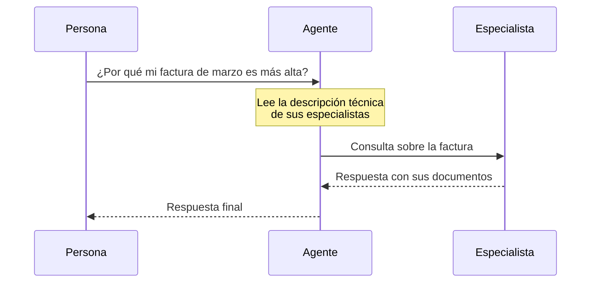

# Especialistas

Un **especialista** es un agente experto en un tema concreto, al que un [agente](/control/estudio/agentes) consulta durante una conversación. No habla con las personas: el agente le pasa la pregunta, el especialista responde al agente y el agente compone la respuesta final.

**Casos de uso:** un asistente comercial que consulta a un especialista en facturación; un asistente de soporte que consulta a un especialista en cada línea de producto.

## Cómo lo usa el agente



1. El agente recibe la pregunta.
2. Lee la **Descripción técnica** de cada especialista asignado y decide si alguno corresponde.
3. Si es así, le pasa la consulta. El especialista responde con sus instrucciones y sus documentos.
4. El agente usa esa respuesta para contestar a la persona.

El agente puede responder sin consultar a ningún especialista, o consultar a varios en la misma respuesta.

### Qué puede hacer un especialista

- Responder con sus **instrucciones del sistema** y sus **documentos**, propios o de carpetas del Centro de Conocimiento compartidas con él.
- Solo puede tener la función integrada **Acceso al centro de conocimiento**: no busca en la web ni usa conectores.
- No puede consultar a otros especialistas. Solo hay un nivel: agente → especialista.

## Crear un especialista

En el Estudio, pestaña **Especialistas**, pulsar **Nuevo especialista**. El formulario es el de [Crear un agente](/control/estudio/crear-un-agente), con estas diferencias:

| | Especialista |
|---|---|
| **Información técnica** | Dos campos obligatorios más (ver abajo) |
| **Imagen** | No tiene |
| **Personalización** (tono e iniciadores) | No tiene |
| **Funciones integradas** | Solo **Acceso al centro de conocimiento** |
| **Acceso** | **Solo yo** o **Mi organización** |

| Campo | Descripción |
|---|---|
| **Nombre técnico** | Identificador interno. Hasta 20 caracteres: letras, números y guion bajo. No puede empezar ni terminar con un número. Ejemplo: `facturacion_clientes` |
| **Descripción técnica** | Hasta 10.000 caracteres. Es lo que lee el agente para decidir **cuándo** consultarlo |

:::warning La descripción técnica decide si se usa
No es una descripción para personas: es el criterio del agente. Debe decir con precisión en qué casos hay que consultar al especialista y en cuáles no. Si es vaga, el agente no lo consultará cuando debe, o lo consultará cuando no toca.
:::

Ejemplo de descripción técnica:

```prompt
Consulta este especialista cuando la persona pregunte por facturas: importes, conceptos, fechas de cobro, duplicados o diferencias entre meses. No lo consultes para precios de productos nuevos ni para incidencias técnicas.
```

## Asignar especialistas a un agente

1. Abrir el detalle del agente.
2. Pestaña **Especialistas** → **Asignar especialista**.
3. Elegir uno o varios y confirmar.

También se puede hacer desde la lista de agentes: cada fila se despliega para mostrar sus especialistas, con el botón **Asignar especialista**.

Para quitar uno, **Desvincular** en la misma pestaña. El especialista no se borra; solo deja de estar disponible para ese agente.

Asignar y desvincular requiere poder editar el agente. Un mismo especialista se puede asignar a varios agentes.

## Buenas prácticas

:::tip Especialistas útiles
- Un especialista por tema bien delimitado, con sus propios documentos.
- Pocas palabras en común entre las descripciones técnicas de los especialistas de un mismo agente, para que no compitan.
- Probar en Conversaciones preguntas que **deben** llegar al especialista y otras que **no**. Encima de la respuesta, [Qué hizo el agente](/conversaciones/conversar-con-un-agente#qué-hizo-el-agente) muestra **Consultó a "…"** cuando lo consultó.
:::
