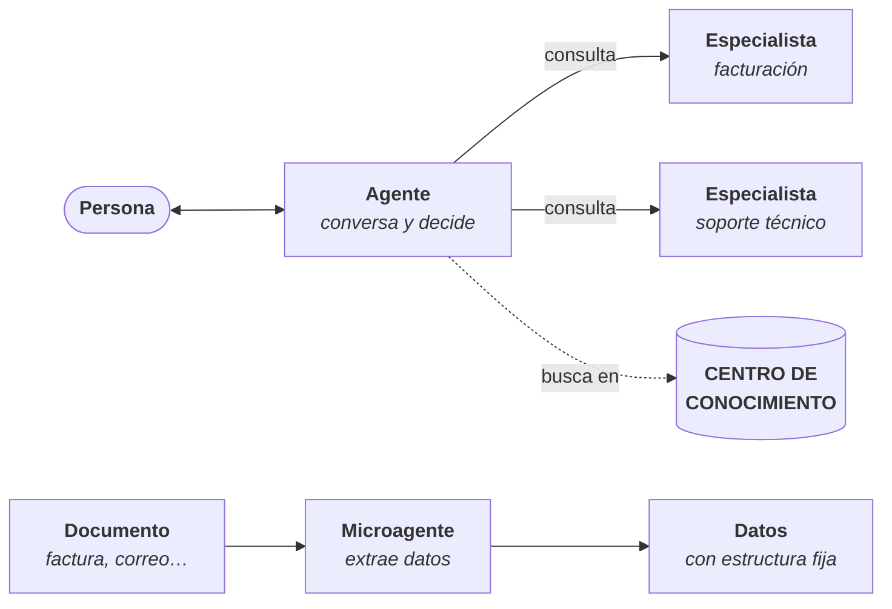

# Estudio

<PageMeta route="/studio">el que corresponda sobre **Estudio**</PageMeta>

El Estudio es donde se crean y configuran los agentes de la organización: qué hacen, cómo responden, qué modelo de IA usan, qué documentos consultan y quién puede usarlos.

Esta sección no requiere conocimientos de programación.

<Screenshot src="/img/estudio/estudio.png" alt="Pantalla del Estudio en ConsulPoint" caption="Estudio" />

## Los tres tipos de agente

| | Agente | Especialista | Microagente |
|---|---|---|---|
| **Qué es** | Agente autónomo que conversa con las personas | Agente experto en un tema, al que un agente consulta | Agente que hace una tarea concreta y devuelve datos con una estructura fija |
| **Con quién habla** | Con las personas, en Conversaciones o en un canal como WhatsApp | Solo con el agente que lo consulta | Con nadie: lo ejecuta la plataforma |
| **Dónde se usa** | Conversaciones, canales conectados, API | Dentro de un agente | Centro de Conocimiento, Bandeja Inteligente y análisis de conversaciones |
| **Ejemplo** | Asistente de atención al cliente | Especialista en facturación | Lector de facturas que extrae proveedor, fecha e importe |
| **Más información** | [Agentes](/control/estudio/agentes) | [Especialistas](/control/estudio/especialistas) | [Microagentes](/control/estudio/microagentes) |

El tipo se elige al crear el agente y no se puede cambiar después.

## Las pestañas

| Pestaña | Contenido |
|---|---|
| **Agentes** | Los agentes de la organización |
| **Especialistas** | Los especialistas disponibles para asignar a agentes |
| **Microagentes** | Los microagentes, con su tipo y su esquema |
| **Habilidades** | Procedimientos reutilizables que se asignan a agentes y especialistas. Ver [Habilidades](/control/estudio/habilidades) |
| **Biblioteca de esquemas** | Estructuras de datos reutilizables por microagentes, carpetas y aplicaciones. Solo aparece con permiso sobre la biblioteca |

En cada pestaña, el botón de la esquina crea un elemento de ese tipo (**Nuevo agente**, **Nuevo especialista**, **Nuevo microagente** o **Nuevo esquema**). Las listas se filtran por nombre y por modelo; la de microagentes, también por tipo.

## El recorrido completo

Para poner en marcha un agente que responda con los documentos de la organización:

1. **Preparar el conocimiento.** Subir los documentos a carpetas del [Centro de Conocimiento](/modulos/centro-de-conocimiento).
2. **Crear el agente** en el Estudio, con sus instrucciones, su modelo y la función integrada **Acceso al centro de conocimiento**. Ver [Crear un agente](/control/estudio/crear-un-agente).
3. **Darle acceso a las carpetas.** Compartirlas con el agente. Ver [Conocimiento de los agentes](/centro-de-conocimiento/conocimiento-de-los-agentes).
4. **Asignarle especialistas**, si hay temas que conviene separar, y **habilidades**, si debe seguir procedimientos concretos. Ver [Especialistas](/control/estudio/especialistas) y [Habilidades](/control/estudio/habilidades).
5. **Decidir quién lo usa**: solo quien lo crea, toda la organización o personas y roles concretos.
6. **Probarlo** en [Conversaciones](/modulos/conversaciones) y revisar las fuentes de cada respuesta.
7. **Conectarlo a un canal**, si va a atender fuera de la plataforma. Ver [Integraciones y canales](/modulos/integraciones).

## Quién puede hacer qué

Con los roles predeterminados:

| Rol | En el Estudio |
|---|---|
| Administrador | Todo |
| Usuario | Crear, ver y editar agentes. No eliminarlos |
| Colaborador | Solo ver |

Además, cada agente tiene su propio [acceso](/control/estudio/agentes#acceso): un usuario solo ve y edita los agentes a los que tiene acceso. La **Biblioteca de esquemas** y los **Conectores** de los agentes son, por defecto, solo para administradores.

El número de agentes que se pueden crear depende del plan contratado. Sin un plan activo, los botones de creación aparecen desactivados.

## Por dónde empezar

| Quiero… | Página |
|---|---|
| Crear mi primer agente | [Crear un agente](/control/estudio/crear-un-agente) |
| Gestionar un agente ya creado: documentos, acceso, eliminarlo | [Agentes](/control/estudio/agentes) |
| Que un agente derive ciertos temas a otro más experto | [Especialistas](/control/estudio/especialistas) |
| Extraer datos de documentos o correos | [Microagentes](/control/estudio/microagentes) |
| Dar a varios agentes un mismo procedimiento | [Habilidades](/control/estudio/habilidades) |
| Definir la estructura de los datos que se extraen | [Biblioteca de esquemas](/control/estudio/esquemas-de-datos) |
| Resolver un problema | [Problemas frecuentes](/control/estudio/problemas-frecuentes) |
