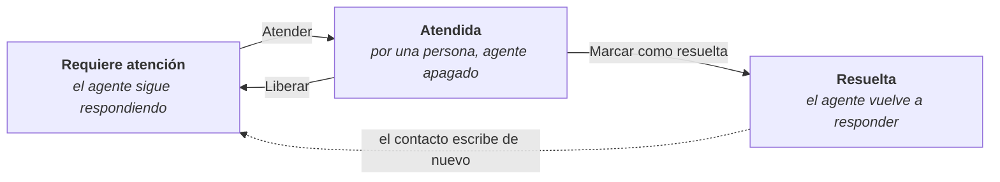

# Canales y atención humana

Cuando un agente está conectado a un canal (un número de WhatsApp, un bot de Telegram o una aplicación externa), las conversaciones con los contactos aparecen en Conversaciones. El agente responde solo, y una persona del equipo puede tomar el control en cualquier momento.

Para conectar un canal, ver [Integraciones y canales](/modulos/integraciones).

## Quién ve las conversaciones de un canal

Las ve el responsable de la integración y su equipo, configurados en la integración. Si el equipo cambia, cambia también quién ve las conversaciones.

En la cabecera, el título es el nombre del contacto y debajo aparecen el canal y el agente que responde. En un [grupo de Telegram](#grupos-de-telegram), el título es el nombre del grupo.

## Tomar el control

En las conversaciones de canales, sobre el cuadro de mensaje aparece quién responde:

| Estado | Significado | Botón |
|---|---|---|
| **El agente … está respondiendo automáticamente** | El agente contesta solo | **Tomar control** |
| **Modo manual: estás respondiendo directamente al canal** | Lo que se escribe llega al contacto tal cual, sin el agente | **Activar agente** |

El ícono del agente, junto al cuadro de mensaje, hace lo mismo. Lo puede usar cualquier persona que participa en la conversación. Mientras el agente está apagado, la cabecera muestra **Agente desactivado**.

## Atención humana

Una conversación queda marcada como **Requiere atención** cuando el agente detecta que hace falta una persona: el contacto pide hablar con alguien, se frustra o el agente no puede ayudarle. También cuando el agente falla al responder.

| Acción | Qué hace |
|---|---|
| **Atender** | La persona se hace cargo y el agente deja de responder. Escribir en una conversación que requiere atención también la atiende |
| **Liberar** | Devuelve la conversación a **Requiere atención** para que la atienda otra persona. El agente sigue apagado |
| **Marcar como resuelta** | Cierra la atención y el agente vuelve a responder |
| **Quitar aviso de atención** | En **Más opciones**. Retira la marca si no hacía falta |

Mientras una persona atiende una conversación, el resto del equipo ve **La atiende…** y no puede escribir en ella.

### Avisos al equipo

- Al marcarse una conversación, el equipo de la integración recibe un aviso.
- Si nadie la atiende en un tiempo (por defecto, 30 minutos), el equipo recibe un nuevo aviso, también por correo.

### Mensajes al contacto mientras espera

Mientras nadie la atiende, el contacto recibe un mensaje inicial, recordatorios periódicos y, si se agota la espera, un aviso de que no hay nadie disponible. Los textos y los tiempos se configuran en cada integración.

## Iniciar una conversación por WhatsApp o Telegram

Desde **Nueva conversación** también se puede escribir primero a un contacto:

| Canal | Qué hace falta |
|---|---|
| **WhatsApp** | **Conexión de WhatsApp**, **Número de teléfono**, **Nombre del contacto (opcional)** y una **Plantilla aprobada**, con sus variables. WhatsApp solo permite iniciar conversaciones con plantillas aprobadas |
| **Telegram** | Un **Contacto existente** o su **ID de chat de Telegram**, y el **Mensaje** |

Cada opción solo aparece con permiso sobre las integraciones y con al menos una conexión de ese canal activa (en WhatsApp, además, sin vencer). Solo se pueden elegir las conexiones activas.

Algunas plantillas de WhatsApp todavía no se pueden enviar desde la plataforma y aparecen como **Todavía no se puede enviar desde aquí**: las que tienen una imagen, un vídeo, un documento o una ubicación en la cabecera, variables en la cabecera, o botones que llevan un dato propio (copiar un código, un código de verificación, un catálogo o un enlace con variable). Se pueden usar las que solo tienen texto, variables en el cuerpo y botones fijos.

## Contactos

Cuando llega una conversación de alguien que no está vinculado a ningún contacto, la plataforma busca uno parecido. Si lo encuentra, la conversación muestra **¿Es …?**, con el dato que coincide, y los botones **Sí, es esta persona** o **Ahora no**.

En **Más opciones**, **Asignar contacto** vincula la conversación a un contacto de la agenda, y **Quitar contacto asignado** lo desvincula.

| Acción | Hace falta |
|---|---|
| Ver la sugerencia **¿Es …?** | Permiso para ver y crear en **Contactos** |
| **Asignar contacto** | Permiso para crear en **Contactos** |
| **Quitar contacto asignado** | Permiso para eliminar en **Contactos** |

En todos los casos, la suscripción tiene que incluir Contactos. En los grupos de Telegram no se sugiere ni se asigna ningún contacto.

## Grupos de Telegram

Un bot de Telegram conectado también se puede añadir a un grupo. Cada grupo es una sola conversación en la plataforma:

- En la lista, en Inicio y en la cabecera aparece con el nombre del grupo y la marca **Grupo**. Si el grupo no tiene nombre, se muestra **Grupo de Telegram**.
- El agente responde a los mensajes del grupo que recibe el bot. Por defecto, Telegram solo le entrega los mensajes que lo mencionan o le responden; para que reciba todos, hay que desactivar el modo privacidad del bot en @BotFather o hacerlo administrador del grupo.
- Un grupo no se vincula a un contacto, porque escriben varias personas. En **Detalles de la conversación**, el **Nombre del grupo** aparece en **Información de la conversación**. Si el grupo quedó vinculado a un contacto antes, se ve como **Contacto asignado** y se puede quitar con **Quitar contacto asignado**.
- El agente no guarda [memoria](/control/estudio/memoria) de un grupo.

## Memoria del contacto

Si el agente tiene [memoria](/control/estudio/memoria), recuerda lo relevante de cada contacto de WhatsApp, Telegram o una aplicación externa: su nombre, su idioma, sus pedidos anteriores y lo que quedó pendiente. Lo usa cada vez que el contacto le escribe.

Los administradores pueden consultarla desde la conversación: en **Más opciones**, **Memoria del agente**, o en **Detalles de la conversación**, **Ver lo que recuerda**. La ventana **Qué recuerda de este contacto** muestra el texto y la fecha de la última actualización.

**Borrar memoria** hace que el agente olvide todo lo que guardó del contacto y empiece de cero en su próxima conversación. No se puede deshacer. La memoria de un contacto no se puede editar.

El agente solo usa y actualiza la memoria al responder al contacto, no con los mensajes del equipo.
