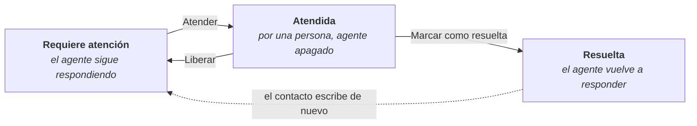

# Canales y atención humana

Cuando un agente está conectado a un canal (un número de WhatsApp, un bot de Telegram o una aplicación externa), las conversaciones con los contactos aparecen en Conversaciones. El agente responde solo, y una persona del equipo puede tomar el control en cualquier momento.

Para conectar un canal, ver [Integraciones y canales](/modulos/integraciones).

## Quién ve las conversaciones de un canal

Las ve el responsable de la integración y su equipo, configurados en la integración. Si el equipo cambia, cambia también quién ve las conversaciones.

En la cabecera, el título es el nombre del contacto y debajo aparecen el canal y el agente que responde.

## Tomar el control

En las conversaciones de canales, sobre el cuadro de mensaje aparece quién responde:

| Estado | Significado | Botón |
|---|---|---|
| **El agente … está respondiendo automáticamente** | El agente contesta solo | **Tomar control** |
| **Modo manual: estás respondiendo directamente al canal** | Lo que se escribe llega al contacto tal cual, sin el agente | **Activar agente** |

El propietario de la conversación también puede activar o desactivar el agente en **Más opciones** → **Respuestas del agente**.

## Atención humana

Una conversación queda marcada como **Requiere atención** cuando el agente detecta que hace falta una persona: el contacto pide hablar con alguien, se frustra o el agente no puede ayudarle. También cuando el agente falla al responder.

| Acción | Qué hace |
|---|---|
| **Atender** | La persona se hace cargo y el agente deja de responder. Escribir en una conversación que requiere atención también la atiende |
| **Liberar** | Devuelve la conversación a **Requiere atención** para que la atienda otra persona. El agente sigue apagado |
| **Marcar como resuelta** | Cierra la atención y el agente vuelve a responder |
| **Quitar aviso de atención** | En **Más opciones**. Retira la marca si no hacía falta |

Mientras una persona atiende una conversación, el resto del equipo ve **La atiende…** y no puede escribir en ella.

### Avisos al equipo

- Al marcarse una conversación, el equipo de la integración recibe un aviso.
- Si nadie la atiende en un tiempo (por defecto, 30 minutos), el equipo recibe un nuevo aviso, también por correo.

### Mensajes al contacto mientras espera

Mientras nadie la atiende, el contacto recibe un mensaje inicial, recordatorios periódicos y, si se agota la espera, un aviso de que no hay nadie disponible. Los textos y los tiempos se configuran en cada integración.

## Iniciar una conversación por WhatsApp o Telegram

Desde **Nueva conversación** también se puede escribir primero a un contacto:

| Canal | Qué hace falta |
|---|---|
| **WhatsApp** | **Conexión de WhatsApp**, **Número de teléfono**, **Nombre del contacto (opcional)** y una **Plantilla aprobada**, con sus variables. WhatsApp solo permite iniciar conversaciones con plantillas aprobadas |
| **Telegram** | Un **Contacto existente** o su **ID de chat de Telegram**, y el **Mensaje** |

Estas opciones solo aparecen con permiso sobre las integraciones.

## Contactos

En **Más opciones**, **Asignar contacto** vincula la conversación a un contacto de la agenda, y **Quitar contacto asignado** lo desvincula.
