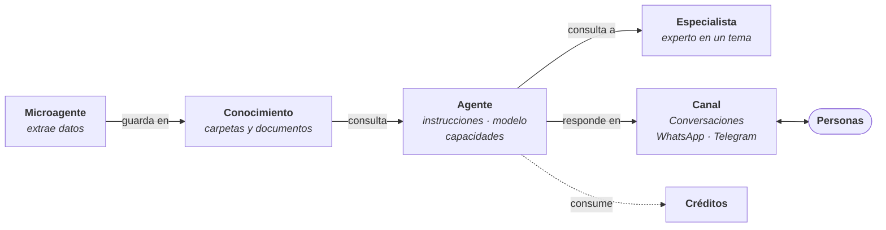

# Conceptos fundamentales

<PageHero eyebrow="Introducción" highlights={['Agentes', 'Conocimiento', 'Canales', 'Créditos']}>
  Los términos que se usan en toda la plataforma y en esta documentación, y cómo encajan entre sí.
</PageHero>

## Cómo encaja todo

Todo ocurre dentro de una **organización**, y puede separarse en **espacios de trabajo**.

Una organización guarda su **conocimiento** en carpetas. Un **agente** lo consulta para responder a las **personas** a través de un **canal**, y puede apoyarse en **especialistas**. Los **microagentes** trabajan sin conversar: leen documentos o correos y extraen sus datos. Todo el uso de IA consume **créditos**.

## Organización

<ModuleGrid>
  <ModuleCard icon="organization" title="Organización">
    La entidad que contrata ConsulPoint: la empresa o institución. Todos sus datos (documentos, agentes, usuarios, conversaciones) le pertenecen y están aislados de los de otras organizaciones.
  </ModuleCard>
  <ModuleCard icon="workspaces" title="Espacio de trabajo" href="/modulos/espacios-de-trabajo">
    Una división interna de la organización, por equipo, departamento, proyecto o cliente, con sus propios miembros, agentes y contenido.
  </ModuleCard>
  <ModuleCard icon="user" title="Rol" href="/organizacion/roles">
    Define qué puede hacer cada persona en cada módulo: ver, crear, editar o eliminar.
  </ModuleCard>
</ModuleGrid>

## Agentes

<ModuleGrid>
  <ModuleCard icon="agent" title="Agente" href="/control/estudio/agentes">
    Asistente de IA que conversa con las personas, en la plataforma o en un canal conectado.
  </ModuleCard>
  <ModuleCard icon="specialist" title="Especialista" href="/control/estudio/especialistas">
    Agente experto en un tema, al que un agente consulta durante una conversación. No habla con las personas.
  </ModuleCard>
  <ModuleCard icon="microagent" title="Microagente" href="/control/estudio/microagentes">
    Agente que hace una tarea concreta, como leer una factura, y devuelve los datos con una estructura fija. No conversa.
  </ModuleCard>
  <ModuleCard icon="instructions" title="Instrucciones del sistema" href="/control/estudio/crear-un-agente#comportamiento-instrucciones-del-sistema">
    El texto que define el papel de un agente, sus límites y cómo responde. Es lo que más influye en la calidad de sus respuestas.
  </ModuleCard>
  <ModuleCard icon="capability" title="Capacidad" href="/control/estudio/crear-un-agente#capacidades">
    Función opcional que se activa en cada agente: consultar el Centro de Conocimiento, buscar en la web, adjuntar archivos, voz…
  </ModuleCard>
  <ModuleCard icon="model" title="Modelo">
    El motor de IA con el que funciona cada agente: de Google, OpenAI o Anthropic, o un modelo propio de la organización si el plan lo incluye.
  </ModuleCard>
</ModuleGrid>

:::warning El tipo es para siempre
Agente, especialista o microagente: el tipo se elige al crearlo y no se puede cambiar después.
:::

## Conocimiento

<ModuleGrid>
  <ModuleCard icon="knowledge" title="Centro de Conocimiento" href="/modulos/centro-de-conocimiento">
    El repositorio de documentos de la organización, del que leen los agentes.
  </ModuleCard>
  <ModuleCard icon="folder" title="Carpeta" href="/centro-de-conocimiento/carpetas-y-archivos">
    La unidad con la que se organiza y se comparte el conocimiento. Un agente lee las carpetas que se comparten con él.
  </ModuleCard>
  <ModuleCard icon="schema" title="Esquema de datos" href="/control/estudio/esquemas-de-datos">
    La estructura que define qué datos se extraen de un documento y con qué forma.
  </ModuleCard>
</ModuleGrid>

## Canales y aplicaciones

<ModuleGrid>
  <ModuleCard icon="integration" title="Integración" href="/modulos/integraciones">
    Conexión con un canal externo (WhatsApp, Telegram, una cuenta de correo) o con otro sistema.
  </ModuleCard>
  <ModuleCard icon="chat" title="Conversación" href="/modulos/conversaciones">
    Un intercambio de mensajes con un agente, en la plataforma o en un canal.
  </ModuleCard>
  <ModuleCard icon="apps" title="Aplicación integrada" href="/aplicaciones-integradas/como-funcionan">
    Aplicación con interfaz propia que se muestra dentro de ConsulPoint y trabaja con los datos de la organización.
  </ModuleCard>
</ModuleGrid>

## Consumo

<ModuleGrid>
  <ModuleCard icon="credits" title="Créditos" href="/organizacion/creditos-y-limites">
    El saldo con el que la organización paga el uso de IA. Cada respuesta, análisis o búsqueda web los consume. Las respuestas de los modelos propios de la organización no consumen créditos.
  </ModuleCard>
  <ModuleCard icon="token" title="Token">
    La unidad en que los modelos miden el texto: lo que se les envía (entrada) y lo que generan (salida). Los tokens consumidos se descuentan en créditos.
  </ModuleCard>
</ModuleGrid>

:::info Si se acaban los créditos
Tras un breve periodo de gracia, los agentes dejan de responder y los análisis se detienen hasta que se recargan.
:::
