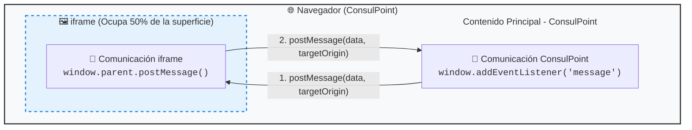

# Conceptos fundamentales

Esta terminología se usa de forma consistente en toda la plataforma y en esta documentación.

## Organización

La entidad contratante. Todos los datos —documentos, agentes, usuarios, conversaciones— pertenecen a una organización y están aislados de las demás. Corresponde a tu empresa.

## Agente

Un asistente de IA configurado por la organización. Existen tres tipos, no intercambiables entre sí:

| Tipo             | Función                             | Interactúa con personas | Devuelve                   |
| ---------------- | ----------------------------------- | ----------------------- | -------------------------- |
| **Agente**       | Asistente principal de conversación | Sí                      | Texto conversacional       |
| **Especialista** | Ayudante invocado por un Agente     | No, indirectamente      | Texto al Agente            |
| **Micro Agente** | Tarea puntual automatizada          | No                      | Datos estructurados (JSON) |

:::warning Restricción
El tipo se define en la creación y **no puede modificarse después**.
:::

## Instrucciones del sistema

El texto que define el comportamiento permanente de un agente: su rol, sus límites y su forma de responder. Es el parámetro de mayor impacto en la calidad del resultado.

## Capacidades

Funcionalidades opcionales que se activan por agente: acceso al conocimiento, búsqueda web, generación de imágenes, procesamiento de audio y archivos.

## Modelo

El motor de IA que ejecuta al agente. La plataforma soporta modelos de **OpenAI, Anthropic y Google**, seleccionables por agente.

## Token

Unidad de medida del consumo de IA. Se contabilizan tokens **de entrada** (lo que se envía al modelo) y **de salida** (lo que el modelo genera). Determinan la facturación.

## Espacio de trabajo

Agrupación interna que aísla usuarios, agentes y aplicaciones por equipo, departamento o proyecto dentro de una misma organización.

## Integración

Conexión configurada con un canal externo (WhatsApp, Telegram, correo) o con un sistema de terceros.

