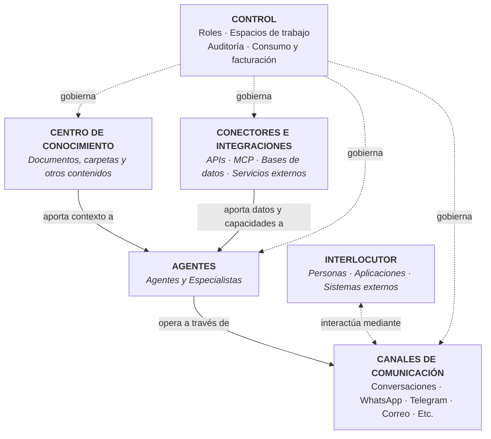
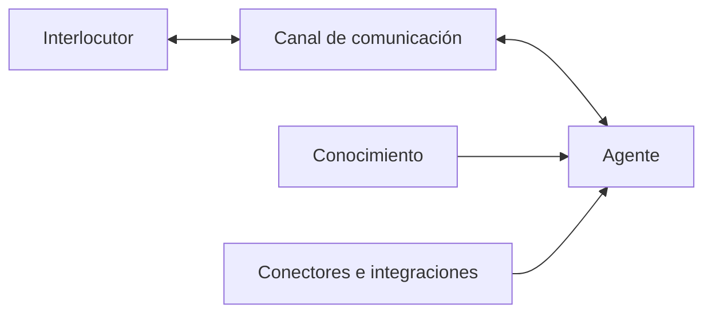

**ConsulPoint es una plataforma de productividad empresarial de nueva generación, diseñada con la inteligencia artificial en el centro**. Reúne conocimiento, agentes, comunicaciones, aplicaciones y automatizaciones en un entorno gobernado para resolver las necesidades diarias de empleados y operarios.

Se integra con los ERP, CRM, CMS y demás sistemas que la organización ya utiliza, y permite incorporar aplicaciones ágiles y específicas que aprovechan sus datos y funciones. Estas herramientas pueden complementar los procesos existentes y sustituir progresivamente determinadas funcionalidades cuando resulte conveniente, al ritmo de cada organización.

Su arquitectura es modular. Cada capacidad puede utilizarse de forma independiente, pero el mayor valor aparece cuando **conocimiento, agentes, canales de comunicación, aplicaciones integradas, conectores, integraciones y automatizaciones** trabajan de forma conjunta bajo un mismo modelo de permisos, trazabilidad, supervisión y control.

## Arquitectura funcional

ConsulPoint se organiza en varios elementos funcionales que trabajan de forma coordinada. La capa de control actúa de forma transversal sobre el resto de la plataforma.



El **conocimiento** proporciona a los agentes información específica de la organización.

Los **agentes** utilizan ese conocimiento, junto con sus instrucciones y capacidades, para responder, razonar o ejecutar tareas.

Los **conectores e integraciones** permiten a los agentes consultar información y ejecutar acciones sobre sistemas externos, como aplicaciones empresariales, bases de datos, servicios web o herramientas de terceros, mediante mecanismos como APIs o MCP.

Los **canales de comunicación** son los medios a través de los cuales los agentes interactúan con personas, aplicaciones o sistemas externos.

El **interlocutor** es la persona, aplicación o sistema que inicia una interacción con ConsulPoint o recibe el resultado de ella.

La **capa de control** define cómo se accede y utiliza cada recurso mediante roles, espacios de trabajo, auditoría y control de consumo.

Un agente puede funcionar sin conocimiento vinculado o sin integraciones externas. En esos casos, operará únicamente con sus instrucciones y con las capacidades disponibles en el modelo configurado.

Como regla general, para configurar un nuevo caso de uso se recomienda seguir este esquema:



La **capa de control** actúa de forma transversal sobre todos los elementos del sistema.

## Qué permite hacer

ConsulPoint permite construir y operar casos de uso de inteligencia artificial sobre el conocimiento, los sistemas y los canales reales de una organización.

La plataforma permite, entre otras capacidades:

- crear asistentes internos y externos apoyados en información propia de la organización;
- atender consultas a través de canales como conversaciones, WhatsApp, Telegram, correo u otros medios integrados;
- conectar agentes con aplicaciones, bases de datos y servicios externos mediante APIs, MCP y otros mecanismos de integración;
- consultar información de sistemas corporativos y utilizarla durante una conversación o proceso;
- ejecutar acciones sobre herramientas externas cuando el agente dispone de las capacidades y permisos necesarios;
- crear agentes especializados para áreas, procesos o funciones concretas;
- analizar mensajes, documentos y otros contenidos para clasificar información, extraer datos o generar respuestas;
- combinar conocimiento, agentes, conectores y canales dentro de un mismo caso de uso;
- mantener supervisión, trazabilidad y control sobre el uso de la inteligencia artificial dentro de la organización.

ConsulPoint no está limitado a un único tipo de asistente o canal. Sus distintos componentes pueden combinarse para adaptarse a procesos internos, atención a clientes, gestión operativa, consulta de información o interacción con sistemas corporativos.

## Seguridad y Aislamiento de datos

La **organización** es el ámbito principal de aislamiento, administración y control dentro de ConsulPoint.

Todos los recursos creados o gestionados en la plataforma pertenecen a una organización concreta. Esto incluye, entre otros:

- usuarios;
- documentos y conocimiento;
- agentes y especialistas;
- conversaciones;
- aplicaciones integradas;
- conectores e integraciones;
- configuraciones;
- espacios de trabajo;
- registros de auditoría.

Los recursos de una organización no forman parte del entorno de otras organizaciones.

Dentro de una misma organización, el acceso a la información y a las capacidades puede restringirse adicionalmente mediante roles, permisos, espacios de trabajo y los permisos asignados a cada recurso.

En el caso de las aplicaciones integradas y las conversaciones con IA, la versión Enterprise incorpora, mediante Advanced Control, una revisión más profunda de los permisos, las capacidades autorizadas y las políticas aplicables. El acceso efectivo y las acciones permitidas dependen tanto de los permisos del usuario como de las capacidades autorizadas para la aplicación o el agente de IA, siempre bajo las políticas de la organización.

Advanced Control permite que organizaciones con requisitos estrictos de control se acerquen a la agilidad de una startup para adoptar IA y desplegar aplicaciones, manteniendo sus estándares de seguridad y gobierno. Para ello, automatiza las verificaciones y aprobaciones dentro de los límites previamente autorizados y deriva a revisión adicional las solicitudes que los exceden.

De forma conceptual:

```text
Acceso efectivo = Permisos del usuario ∩ Permisos del recurso o aplicación ∩ Políticas de la organización
```
