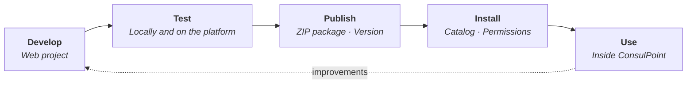

# Integrated apps

An **integrated app** is a small web app shown inside ConsulPoint that works with your organization's data: documents, contacts, conversations or its own records. It solves a specific task with a custom-built screen, for example reviewing orders received by email or managing requests.

In [Conversations](/modulos/conversaciones) a person talks to an agent. In an integrated app they work with a screen designed for a specific task, and what the platform has already done, such as extracting data from a document or analyzing a conversation, reaches them as ready-to-use information.

**The app provides the user experience; ConsulPoint provides the data, the permissions and the control.**

This section explains how they work, how they are developed and how they reach users.

## Where to start {#por-dónde-empezar}

**If you decide or administer**

Understand what they are, install them and control what they can do.

- [How they work](/aplicaciones-integradas/como-funcionan)
- [Where they appear](/aplicaciones-integradas/donde-aparecen)
- [Install and manage](/aplicaciones-integradas/instalar-y-administrar)

**If you develop** <TabHint label="Developers" />

Build an app, test it and publish it.

- [Your first app](/aplicaciones-integradas/desarrollar/primera-aplicacion)
- [Starter template](/aplicaciones-integradas/desarrollar/plantilla-de-inicio)
- [Publish](/aplicaciones-integradas/publicar)

**If you provide support**

Solve a specific problem.

- [Common issues](/aplicaciones-integradas/problemas-frecuentes)
- [Technical reference](/aplicaciones-integradas/referencia)

## The full journey {#el-recorrido-completo}

1. **Develop**: the app is a regular web project that, when built, produces static files.
2. **Test**: first on the developer's computer, with test data; then inside the platform.
3. **Publish**: a ZIP package is uploaded with a version.
4. **Install**: each organization adds it from the catalog, or creates it as its own app.
5. **Use**: it appears in the places of the platform that match its type.

## Two origins {#dos-orígenes}

| Origin | Who creates it | Who maintains it |
|---|---|---|
| **Installed** | It is published in the [Integrations catalog](/organizacion/catalogo-de-aplicaciones) and each organization installs it | Whoever published it: its versions, permissions and data models arrive with each update |
| **Custom** | The organization, from **Settings → Apps** | The organization itself |

:::tip Before building from scratch
Check the [Integrations catalog](/organizacion/catalogo-de-aplicaciones) first: an equivalent app may already exist.
:::
