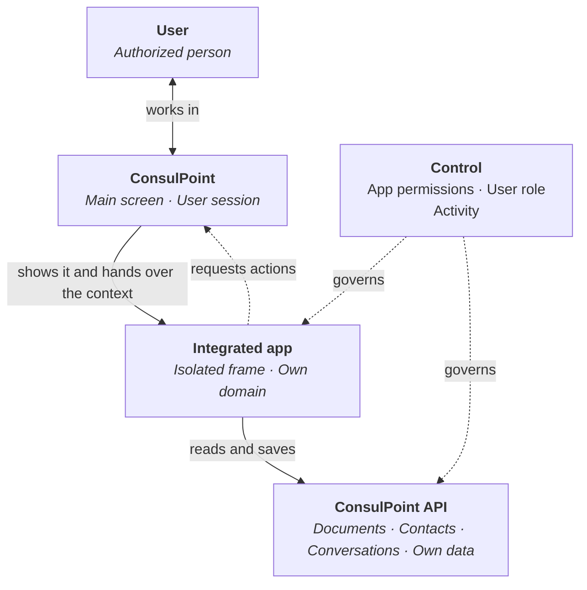

# How they work

An integrated app is shown inside ConsulPoint, but it runs **isolated** from the platform. It receives only what it needs to work and accesses the organization's data through the API, with the permissions it has been granted.

This page requires no programming knowledge.

<Screenshot src="/img/en/aplicaciones-integradas/aplicacion-abierta.png" alt="An integrated app open inside ConsulPoint" caption="A sample integrated app, open inside ConsulPoint" />

## Functional architecture {#arquitectura-funcional}



**ConsulPoint** shows the app in a frame inside its screen and hands it the **context**: language, theme, a temporary session and the data of the place where it was opened, such as the folder or the conversation.

The **integrated app** is loaded from a domain different from the platform's. That is why the browser prevents it from reading the main screen or the user's session.

The **API** is the only way to read or save the organization's data. Every request carries the app's temporary session.

The **control layer** decides what it can do: it combines the permissions granted to the app with the role of the person using it.

## The app's session {#la-sesión-de-la-aplicación}

When an app is opened, the platform creates a **temporary session** for it, separate from the user's session.

| Feature | Value |
|---|---|
| Duration | 30 minutes |
| Renewal | Automatic, as long as the app stays open |
| Scope | Only that app, that organization and that person |
| Delivery | After the app loads; never in the page address |

## What it can do {#qué-puede-hacer}

- read and save the data it has permission for;
- save its own records in its [data models](/aplicaciones-integradas/desarrollar/datos-propios);
- ask the platform to refresh what it shows, open one of its pages, open an external link or show an email;
- record in the activity who did what.

## What it cannot do {#qué-no-puede-hacer}

- access the user's session or the ConsulPoint main screen;
- use data it does not have permission for, even if the person does;
- act beyond the role of the person using it, except for **Contacts**, where the app's permission is enough;
- open windows or tabs on its own;
- work outside ConsulPoint: opened directly in the browser, it gets no session.

Conceptually:

```text
App access =
App permissions
∩ Role of the user using it
```

:::warning Browser storage
Browser storage is only for interface preferences. All integrated apps are served from the same domain, so `localStorage`, `sessionStorage`, IndexedDB and cookies are **shared with the other apps**, including those of other organizations. Data that must be kept or protected is saved on the platform, not in the browser.
:::
