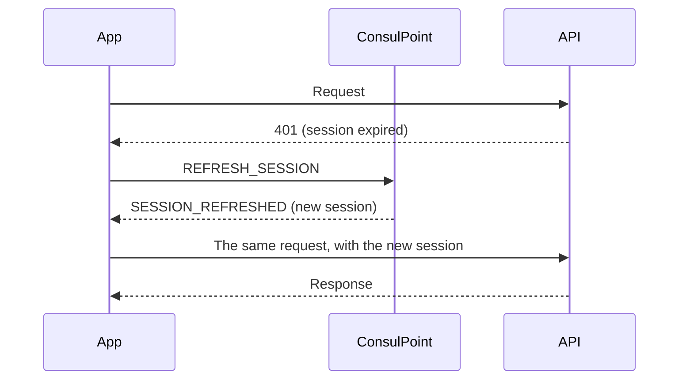

# Calling the API

The app queries and saves organization data through the ConsulPoint API. Each request is identified with the temporary session it received in the context.

## Required headers {#cabeceras-obligatorias}

```text
Authorization: Bearer {token}
X-Mini-App-Id: {miniAppId}
```

Always build the address from `apiBaseUrl`. Keep all requests in a single function:

```ts title="src/services/api.ts"
import { getConfig } from '../config';

export async function sessionFetch(path: string, init: RequestInit = {}) {
  const { token, apiBaseUrl, miniAppId } = getConfig();
  return fetch(`${apiBaseUrl}${path}`, {
    ...init,
    headers: {
      Authorization: `Bearer ${token}`,
      'X-Mini-App-Id': miniAppId,
      ...(init.headers ?? {}),
    },
  });
}
```

## Renew the session {#renovar-la-sesión}

The session lasts **30 minutes**, but the app can stay open much longer. When a request returns `401`, the app asks the platform for a new session and retries the request once.



Rules:

- A `401` response means the server did nothing, so retrying the request is safe even when saving.
- Several expired requests at once share a single renewal. If another renewal is requested within the next 30 seconds, the platform returns the same session.
- If the platform responds `SESSION_REFRESH_FAILED`, or doesn't respond within about 8 seconds, show your own **session expired** state that invites the user to open the app again.
- Keep the new session in memory, never in browser storage.

The message format is in [Communicating with the platform](/aplicaciones-integradas/desarrollar/comunicacion).

## Who is using the app {#quién-está-usando-la-aplicación}

To attribute actions or show the person's name, ask the platform for the identity:

```text
GET {apiBaseUrl}/mini-apps/v2/{miniAppId}/session
```

```json
{ "userId": "…", "userName": "Ana García", "tenantId": "…", "miniAppId": "…" }
```

`userName` can be `null`. Don't get the identity by decoding the token or reading it from the address: those values can be tampered with in the browser.

## Permissions {#permisos}

An app only accesses the resources it has been granted:

| Resource | Possible operations |
|---|---|
| **Knowledge Hub** | Read · Create · Update · Delete |
| **Smart Inbox** | Read · Create · Update · Delete |
| **Conversations** | Read · Create · Update · Delete |
| **Contacts** | Read only |
| **Users** | Read only |

The app acts **on behalf of the person using it**: besides the app's permission, that person needs access to the resource through their role. The exception is **Contacts**, where the app's permission is enough.

Without permission, the API responds `403`. Treat it as "unavailable" and keep the rest working, not as a full-screen error.

Permissions are granted when you [publish](/aplicaciones-integradas/publicar) or [manage](/aplicaciones-integradas/instalar-y-administrar) the app.

## Record activity {#registrar-actividad}

The app can keep a record of who did what. The server sets the date and the person.

```text
POST {apiBaseUrl}/mini-app-runtime/activity
```

```json
{
  "recordId": "order-1042",
  "action": "ORDER_CONFIRMED",
  "changes": [{ "field": "status", "before": "pending", "after": "confirmed" }]
}
```

You query a record's activity with `GET /mini-app-runtime/activity?recordId=…`, and an administrator reviews it in the app's **Activity** tab.

## Best practices {#buenas-prácticas}

:::warning Request rate
The API limits the number of requests per interval. On a `429` response, wait and retry; avoid querying in a loop.
:::
