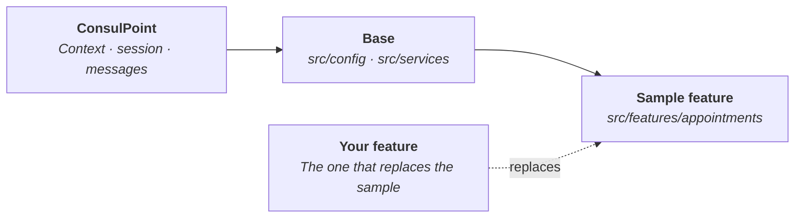

# Starter template

The starter template is a public repository with a small, complete integrated app: an **appointment scheduler** that books an appointment for a contact, confirms or cancels it and prepares the confirmation message for the conversation.

Use it to see how an app integrates with ConsulPoint in real code, and as a starting point for your own app: keep the base and replace the sample feature.

**Repository:** [github.com/akui-solutions/consul-point-app-starter](https://github.com/akui-solutions/consul-point-app-starter)

<Screenshot src="/img/en/aplicaciones-integradas/plantilla-agenda.png" maxWidth={680} alt="Starter template Appointments screen, with upcoming appointments grouped by day" caption="The template's appointment scheduler, in demo mode" />

**Requirements:** Node.js 20 or later and **yarn** or **pnpm**.

## Run it locally {#verla-en-local}

You don't need an account. Demo mode works offline, with made-up data that is lost when you reload the page.

```bash
git clone https://github.com/akui-solutions/consul-point-app-starter.git
cd consul-point-app-starter
yarn install
yarn dev:mock
```

The terminal shows the address where it opens. To try the variants, add parameters to that address: `?theme=dark` or `?language=en`.

## What it looks like {#cómo-se-ve}

All screenshots are from demo mode: the people and appointments are made up.

<Screenshot src="/img/en/aplicaciones-integradas/plantilla-form.png" maxWidth={680} alt="Starter template New appointment form, with two contacts suggested while typing" caption="When booking, the app suggests contacts from the organization" />

<Screenshot src="/img/en/aplicaciones-integradas/plantilla-menu.png" maxWidth={680} alt="Actions menu of an appointment in the template: Insert confirmation into the message, View contact, Add to Google Calendar, Edit appointment, Cancel appointment and Delete appointment" caption="The actions for each appointment, including the ones requested from the platform" />

<Screenshot src="/img/en/aplicaciones-integradas/plantilla-panel.png" maxWidth={320} alt="Template appointment scheduler in dark theme, at the width of a conversation's side panel" caption="The same scheduler in dark theme, at the width of a conversation's side panel" />

## What it teaches {#qué-enseña}

Each feature of the scheduler maps to one part of the integration.

| What the app does | What it teaches | Related page |
|---|---|---|
| Opens with the user's language and theme | Reading the context the platform provides | [Context it receives](/aplicaciones-integradas/desarrollar/contexto) |
| Records who booked each appointment | Getting the user's verified identity | [Calling the API](/aplicaciones-integradas/desarrollar/api-y-sesion) |
| Keeps working after half an hour | Renewing the session without reloading | [Calling the API](/aplicaciones-integradas/desarrollar/api-y-sesion) |
| Saves, edits and deletes appointments | Keeping your own records in a data model | [Own data](/aplicaciones-integradas/desarrollar/datos-propios) |
| Suggests contacts when booking | Reading organization data with a permission | [Reference](/aplicaciones-integradas/referencia) |
| Books even without that permission | Treating a missing permission as an unavailable feature, not as an error | [Common issues](/aplicaciones-integradas/problemas-frecuentes) |
| Inserts the confirmation into the message, opens the contact's record and opens an external link | Asking the platform for actions | [Communicating with the platform](/aplicaciones-integradas/desarrollar/comunicacion) |
| Works offline with made-up data | Working on the interface before you have an environment | [Test](/aplicaciones-integradas/desarrollar/probar) |

The repository's `README.md` file says which file each one is in. It's written in English, like the code comments; the app works in Spanish and English.

## Create an app from the template {#crear-una-aplicación-a-partir-de-la-plantilla}



The base stays as is; what changes is the feature.

1. On the repository page, click **Use this template** and create a new repository. It gets the files, not the history, and it can be private.
2. Change the name `consul-point-app-starter` in `package.json`, the default identifier in `src/config/index.ts` and the title in `index.html`.
3. Replace the `src/features/appointments/` folder with your own feature, keeping its shape: types, texts, logic and screen kept separate.
4. Define the data models in `MODELS.md` and replace the made-up data in `src/services/`.
5. Adjust the accent color in `src/styles/tokens.css`.

The `src/services/` and `src/config/` folders contain the communication with the platform and don't need changes to get started.

## Publish it in ConsulPoint {#publicarla-en-consulpoint}

1. Run `yarn package`. It generates a ZIP file with `index.html` at the root.
2. Create the app with the **Extension** type and upload the ZIP as its first version.
3. In the **Models** tab, create the `appointment` model with the schema from the `MODELS.md` file.
4. In the **Permissions** tab, grant read access on **Contacts**. This is optional: without that permission, the person's name is typed by hand.

Each step is explained in detail in [Publish](/aplicaciones-integradas/publicar).

## What it includes besides the sample {#qué-trae-además-del-ejemplo}

| Includes | What for |
|---|---|
| Tests for the communication with the platform | Catch a change that breaks the integration before publishing it |
| Tests for the sample feature | Serve as a model for your app's own tests |
| Code and formatting checks | Keep the style consistent as the project grows |
| Continuous integration workflow | Run checks, tests and the build on every proposed change |

## Best practices {#buenas-prácticas}

:::tip Keep the base
Change the sample feature first and leave the `src/services/` folder for later: its tests pin down how the app talks to the platform.
:::

:::info License
The template is published under the MIT license: you can copy, modify and use it in your own projects.
:::
