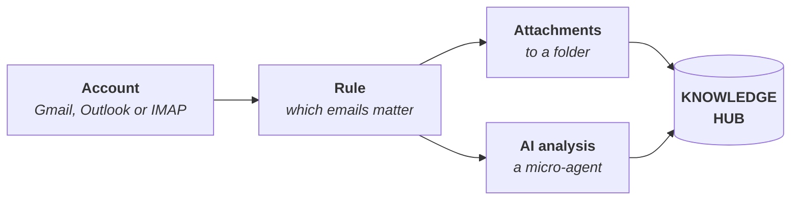

# Smart Inbox

<PageMeta route="/smart-inbox">the relevant one on **Smart Inbox**. With the default roles, only administrators</PageMeta>

The Smart Inbox shows the email from connected accounts (Gmail, Outlook or any IMAP account) inside ConsulPoint. With **email rules**, it picks out the emails that matter, saves their attachments to the [Knowledge Hub](/modulos/centro-de-conocimiento) and analyzes them with AI to get a summary, the key data and the pending actions.

This section does not require any programming knowledge.

<Screenshot src="/img/en/bandeja-inteligente/bandeja-inteligente.png" alt="Smart Inbox screen in ConsulPoint" caption="Smart Inbox" />

:::info Email, not messaging
The Smart Inbox works with **email**. WhatsApp and Telegram conversations are handled from [Conversations](/modulos/conversaciones). It also does not send or reply to emails: you keep doing that from your usual email program.
:::

## How it works {#cómo-funciona}

1. **You connect an email account** in Settings. See [Connect an account](/bandeja-inteligente/conectar-una-cuenta).
2. **You create a rule** that says which emails matter (by sender, domain or subject words) and what to do with them. See [Email rules](/bandeja-inteligente/reglas-de-correo).
3. **The attachments** of those emails are saved to a Knowledge Hub folder.
4. **A micro-agent** analyzes each email and generates a summary, which can also be saved to a folder. See [AI analysis](/bandeja-inteligente/analisis-con-ia).

Once in the Knowledge Hub, those documents can be [shared with agents](/centro-de-conocimiento/conocimiento-de-los-agentes) so they can answer with them.

:::warning Nothing is processed on its own
Saving attachments and analyzing emails is started from the platform, one email at a time or in batches (**Process attachments**, **Analyze pending**). The Smart Inbox does not check the mailbox on its own in the background.
:::

## Where to find it {#dónde-está}

In the top bar, the inbox icon opens the Smart Inbox. It only appears for people with permission on it.

Rules are managed in **Settings → Email rules**, and email accounts in **Settings → Connectors**.

The Smart Inbox is not available inside a [workspace](/modulos/espacios-de-trabajo): you use it from the main organization.

## Where to start {#por-dónde-empezar}

| I want to… | Page |
|---|---|
| Connect my email account | [Connect an account](/bandeja-inteligente/conectar-una-cuenta) |
| Search and read emails in the platform | [Read email](/bandeja-inteligente/leer-el-correo) |
| Automatically save attachments from certain senders | [Email rules](/bandeja-inteligente/reglas-de-correo) |
| Get summaries and data from emails | [AI analysis](/bandeja-inteligente/analisis-con-ia) |
| Solve a problem | [Common issues](/bandeja-inteligente/problemas-frecuentes) |
