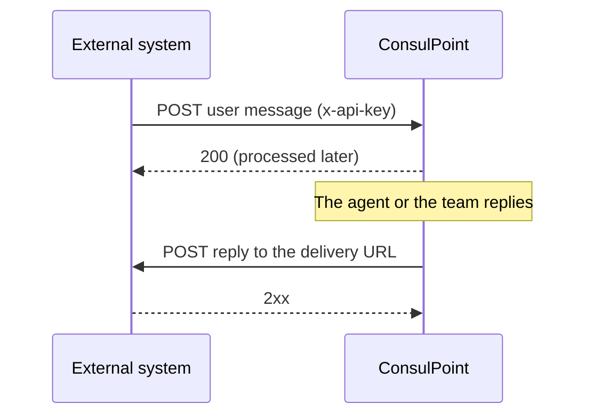

# External app channel API

This page is for whoever develops the system that connects to ConsulPoint as an [external app](/organizacion/canales/aplicacion-externa): your own app or website whose users talk to an agent or to the organization's team.

The exchange goes both ways:



## What you need {#lo-que-se-necesita}

An administrator of the organization creates the channel and hands over:

| Item | What for |
|---|---|
| **Channel identifier** (`integrationId`) | Goes in the path of every request. For now, ask ConsulPoint support for it |
| **API key** | Authenticates every request, in the `x-api-key` header |
| **Signing secret** | Signs the messages you send (if the signature is required) and lets you verify the signature of the replies |
| **API address** | The same one the platform uses; support gives it to you together with the identifier |

The external system provides its **delivery URL** (HTTPS, on a public domain, with no redirects) and a **Delivery API Key**, which the administrator configures in the channel.

The paths on this page are relative to the API address.

## Send a message {#enviar-un-mensaje}

```
POST /webhooks/external-app/inbound/{integrationId}
```

| Header | Required | Content |
|---|---|---|
| `x-api-key` | Yes | The channel's API key |
| `Content-Type` | Yes | `application/json` |
| `x-signature` | Only with required signature | Signature of the body (see [Signature](#firma)) |
| `x-signature-timestamp` | Only with required signature | Time of sending, in Unix seconds |

```json
{
  "externalUserId": "user-1234",
  "user": {
    "displayName": "Alex Morgan",
    "language": "en",
    "metadata": { "plan": "premium", "appVersion": "4.3.2" }
  },
  "message": {
    "externalMessageId": "msg-0001",
    "role": "user",
    "content": "What are your opening hours on Saturday?",
    "sentAt": "2026-11-12T10:15:00Z",
    "attachments": [],
    "metadata": { "screen": "help" }
  }
}
```

| Field | Required | What it is |
|---|---|---|
| `externalUserId` | Yes | The user's identifier in the external system. Always the same for the same person: it groups their messages into a conversation |
| `user.displayName` | No | Name shown in the panel |
| `user.language` | No | The user's language, in ISO 639-1 format (`es`, `en`, `pt`…). Sending it once is enough. Replies are delivered translated into that language |
| `user.metadata` | No | Any user data, in whatever format you want. It is stored as is |
| `message.externalMessageId` | Yes | Unique identifier of the message in the external system. See [Repeated messages](#mensajes-repetidos) |
| `message.role` | Yes | `user` for a user message; `assistant` for a reply generated by the external system's own AI (it is stored as context, but does not make the agent reply) |
| `message.content` | Yes, unless there are attachments | The text |
| `message.attachments` | No | Up to 5 attachments. See [Attachments](#adjuntos) |
| `message.sentAt` | No | Actual time of the message, in ISO 8601 |
| `message.metadata` | No | Data specific to this message, for example a location. It is stored as is |

### Responses {#respuestas}

| Code | Meaning |
|---|---|
| `200` | Accepted. It is processed later: it does not mean it is already visible in the panel |
| `401` | Signature missing, expired or incorrect (with required signature) |
| `403` | API key missing or incorrect |
| `429` | More than 120 requests per minute on the channel |

### Repeated messages {#mensajes-repetidos}

If the same `externalMessageId` is sent twice (for example, when retrying after a network error), the second send is ignored without an error. That is why the identifier must be unique per message: if it is reused for a different message, that message is discarded.

### Attachments {#adjuntos}

Attachments do not travel in the JSON: you send a public HTTPS URL from which ConsulPoint downloads them.

```json
{ "kind": "audio", "url": "https://cdn.example.com/media/note-559.ogg", "mimeType": "audio/ogg", "filename": "note.ogg" }
```

- Types: images `image/jpeg`, `image/png`, `image/webp`; audio `audio/ogg`, `audio/mpeg`, `audio/mp4`.
- Up to 16 MB per attachment and 5 per message. The URL must remain valid for a few minutes and cannot redirect.
- An attachment that cannot be downloaded is discarded, and the rest of the message is processed anyway.
- If the channel has an agent, it transcribes voice notes (using credits according to their duration) and takes images into account.

### Conversations {#conversaciones}

Messages from the same `externalUserId` form one conversation as long as the **inactivity time** configured in the channel (30 minutes by default) does not pass. After that time, the next message opens a new conversation. If the previous conversation was resolved, a new message reopens it.

## Receive the replies {#recibir-las-respuestas}

Every time the agent or the team replies, ConsulPoint makes a `POST` to the delivery URL, with the **Delivery API Key** in `x-api-key` and the signature in `x-signature` and `x-signature-timestamp`:

```json
{
  "externalUserId": "user-1234",
  "message": {
    "messageId": "clx0abc123",
    "content": "On Saturdays we are open from 9:00 to 14:00.",
    "originalContent": "On Saturdays we are open from 9:00 to 14:00.",
    "language": "en",
    "sentAt": "2026-11-12T10:15:08Z",
    "attachments": [
      {
        "kind": "image",
        "url": "https://…",
        "mimeType": "image/jpeg",
        "filename": "hours.jpg",
        "expiresAt": "2026-11-12T11:15:08Z"
      }
    ]
  }
}
```

| Field | What it is |
|---|---|
| `externalUserId` | The user the reply must be delivered to |
| `message.messageId` | Identifier of the reply. Use it to avoid delivering the same one twice |
| `message.content` | The text, already translated into the user's language. It can be empty if there are only attachments |
| `message.originalContent` | The original text, only if it was translated |
| `message.language` | Language of `content` |
| `message.attachments` | Attachments (`image`, `video`, `audio` or `file`), each with a temporary URL that expires in **1 hour**. Download them when you receive the delivery |

The delivery URL must respond with a `2xx` code. If it fails, ConsulPoint retries up to **5 times**, with increasing waits starting at 30 seconds; each retry arrives with the same `messageId`. After that, the delivery is recorded as failed.

## Signature {#firma}

When the signature is required, every message you send carries a signature; and all the replies ConsulPoint delivers carry one, so the external system can verify that they come from ConsulPoint.

```
x-signature = hex( HMAC_SHA256( signingSecret, "{timestamp}.{body}" ) )
```

- `{timestamp}` is the value of `x-signature-timestamp`, in Unix seconds.
- `{body}` is the **exact bytes** of the request body. When signing, serialize the JSON only once and send those same bytes; when verifying, use the body as it arrives, before parsing it into an object.
- A signature more than **5 minutes** away from the current time is rejected.

Verification example in Node.js:

```js
const crypto = require('crypto');

function isValidSignature(rawBody, headers, secret) {
  const timestamp = headers['x-signature-timestamp'];
  if (Math.abs(Date.now() / 1000 - Number(timestamp)) > 300) return false;
  const expected = crypto
    .createHmac('sha256', secret)
    .update(`${timestamp}.${rawBody}`)
    .digest('hex');
  const received = headers['x-signature'] ?? '';
  return (
    expected.length === received.length &&
    crypto.timingSafeEqual(Buffer.from(expected), Buffer.from(received))
  );
}
```

## Get the history {#consultar-el-histórico}

```
GET /webhooks/external-app/{integrationId}/messages?externalUserId={id}&limit=50&cursor={cursor}
```

With the same API key (and the signature, if required; in that case you sign the path with its parameters). It returns all the user's messages, from all their conversations, from oldest to newest:

```json
{
  "externalUserId": "user-1234",
  "messages": [
    { "id": "clx0abc120", "role": "user", "content": "What are your opening hours…?", "language": "en", "sentAt": "…", "externalMessageId": "msg-0001" },
    { "id": "clx0abc123", "role": "assistant", "content": "On Saturdays…", "language": "en", "sentAt": "…", "externalMessageId": null }
  ],
  "nextCursor": "MjAyNi0xMS0xMl…"
}
```

- `limit`: up to 100 per page (50 by default).
- Keep requesting pages with `nextCursor` until it is `null`. A page may contain fewer messages than `limit`, or none, and still have `nextCursor`.
- It does not include attachments or automatic waiting messages.
- Limit: 60 requests per minute.

## Before going to production {#antes-de-salir-a-producción}

- [ ] The API key and the signing secret are stored like passwords, never in the code or in logs.
- [ ] Every message carries a unique `externalMessageId`.
- [ ] The delivery URL is HTTPS, public, with no redirects, and responds `2xx`.
- [ ] Delivery does not duplicate replies with the same `messageId`.
- [ ] Reply attachments are downloaded when received.
- [ ] If the channel has an agent assigned, the external system's own AI is turned off, so the user does not receive two replies.
