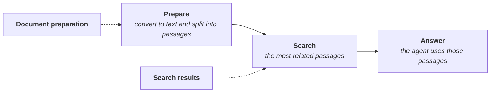

# Agents' search

<PageMeta route="/knowledge-hub">edit on **Knowledge Hub** and being able to edit the folder</PageMeta>

When an agent answers with the documents in a folder, it first **searches** them for the passages related to the question and then answers based on those passages. **Agents' search** lets you adjust that process for each folder: how its documents are prepared and what information the agent receives in each search.

The platform's settings work well in most cases. Adjust them when the answers don't find what's in the documents: records that are very similar to each other, manuals with long procedures, complex tables or drawings with information in images.

**Use cases:** a folder of product records where the agent mixes them up; a folder of regulations where procedures arrive cut in half; a sector with its own acronyms that the agent doesn't recognize.

## How an agent searches {#cómo-busca-un-agente}

1. **Prepare.** When a document reaches a folder shared with an agent, the platform converts it to text and splits it into **passages**: pieces of text of a similar size. Each passage is stored so it can be searched by meaning, not only by exact words.
2. **Search.** For each question, a **search agent** looks for the most related passages in the folders the agent has access to.
3. **Answer.** The agent writes the answer with those passages. It doesn't read the full documents.

The settings are split into two groups, one for each moment:

| Group | What it adjusts | When you notice a change |
|---|---|---|
| **Document preparation** | How documents are split and how their tables and images are read | In documents prepared afterwards. The existing ones stay as they were until they're **updated**. See [Update the documents](/centro-de-conocimiento/actualizar-los-documentos) |
| **Search results** | How many passages the agent receives and which search agent it uses | From the next message, without having to update anything |

## Which folders it applies to {#a-qué-carpetas-se-aplica}

The settings are defined on the **folder that is shared with the agent** (or an agent's own folder) and apply to it and all its subfolders. If there's another folder inside that is shared with an agent separately, that one uses its own settings.

That's why the option only appears on folders shared with some agent. [Multimedia](/centro-de-conocimiento/multimedia) folders don't have it.

## Open the settings {#abrir-la-configuración}

<Screenshot src="/img/en/centro-de-conocimiento/busqueda-menu.png" alt="Menu of a Knowledge Hub folder with the Configure agents' search option" caption="Menu of a folder shared with an agent" maxWidth={520} />

You can open the **Agents' search** window from several places:

- In the folder's **⋯** menu, or in the title menu inside it: **Configure agents' search**.
- In **Edit folder**, under **Advanced options**: the **Agents' search** row, which shows the settings in use and how many documents need updating.
- In the folder's information (**View details**), with **Review and update**, when there are documents pending an update.
- By clicking the orange mark for pending documents next to the folder's name.

You need edit permission on the **Knowledge Hub** and to be able to edit the folder: be the person who created it, or have **Can edit** or **Can manage** if it's shared. If you can only view it, you can check the settings in the folder's information.

## Settings source {#origen-de-la-configuración}

The first thing in the window is where the settings come from:

| Source | What it means | When to choose it |
|---|---|---|
| **Default** | The platform-wide settings. They're shown for reference, but you can't change them | For most folders |
| **Profile** | Named settings shared by several folders. You choose it in **Search profile**, and its values are shown for reference | When several folders have the same kind of documents. See [Search profiles](/centro-de-conocimiento/perfiles-de-busqueda) |
| **Own** | Settings for this folder only, which you can edit | For a folder with particular needs, or to prepare a new profile |

A profile applies as a whole: you can't change a single setting for one folder. For that, **Use as own settings** copies the profile's values to the folder, which switches to **Own** and can then be adjusted.

If there are no profiles yet, the **Profile** option is disabled.

## Document preparation {#preparación-de-documentos}

<Screenshot src="/img/en/centro-de-conocimiento/busqueda-preparacion.png" alt="Document preparation group in the Agents' search window" caption="Agents' search → Own → Document preparation" maxWidth={480} />

Sets how the folder's documents are prepared.

:::warning Changes aren't applied on their own
Documents that were already prepared keep the previous settings until they're updated. When you save a change in this group, the platform shows how many documents it affects and offers to update them. See [Update the documents](/centro-de-conocimiento/actualizar-los-documentos).
:::

### Content type {#tipo-de-contenido}

The size of the passages the documents are split into. Pick the one closest to the folder's documents:

| Option | For | What it does |
|---|---|---|
| **General (recommended)** | Most documents | Medium-sized passages. This is the default option |
| **Short records** | Many brief documents: records, FAQs, catalogs, directories | Small passages, so each record gets its own passage and doesn't get mixed with the next one |
| **Long documents** | Manuals, contracts, regulations and long reports | Large passages, so a long procedure arrives whole |
| **Custom** | Cases that don't fit the previous ones | You set the sizes by hand |

Technical detail: sizes are measured in **tokens**, the unit models use to count text (100 tokens are about 75 words).

| Option | Size of each fragment | Text repeated between fragments | Join fragments shorter than |
|---|---|---|---|
| **General** | 1,000 | 100 | 200 |
| **Short records** | 400 | 0 | 80 |
| **Long documents** | 1,500 | 150 | 500 |

With **Custom**, the three values appear, starting from the option that was selected:

| Field | What it does | Values |
|---|---|---|
| **Size of each fragment** | The maximum size of each passage | From 200 to 1,800 tokens |
| **Text repeated between fragments** | The end of one passage is repeated at the start of the next, so an idea isn't cut in half | From 0 to a quarter of the size |
| **Join fragments shorter than** | Very short sections are joined to the next one until they reach this size | From 50 to the passage size |

### Table reading {#lectura-de-tablas}

| Option | What it does |
|---|---|
| **Fast** | Faster. May lose detail in complex tables or merged cells. This is the default option |
| **Accurate** | Slower. Reads complex tables and merged cells well |

It applies to documents that aren't PDFs and to PDFs converted with the **Essential** service (see [PDF conversion](/centro-de-conocimiento/carpetas-y-archivos#conversión-de-pdf)).

### PDF images {#imágenes-de-los-pdf}

| Setting | What it does |
|---|---|
| **Describe the PDFs' images** | The platform uses AI to describe charts, photos and diagrams, so agents find what they show |
| **Skip decorative images** | Logos, icons and ornaments aren't described. Only with the previous one turned on |
| **Maximum length of each description (characters)** | From 100 to 1,000. Raise it if the images contain data, such as charts or tables saved as images |

Only available if the folder converts PDFs with the **Advanced** service and **Keep the images**. Otherwise, the window says so and offers **Change the PDF conversion**, which opens **Edit folder**.

### Advanced options {#opciones-avanzadas}

| Setting | What it does | When to turn it on |
|---|---|---|
| **Include the section title in each passage** | Each passage is also searched by the document's name and its section's headings | Records that are very similar to each other: that way "9 am to 6 pm" stays linked to "Museum X > Opening hours" |
| **Repeat table headers in each passage** | If a long table is split into several passages, each one repeats the header row | Documents with long tables |

## Search results {#resultados-de-búsqueda}

<Screenshot src="/img/en/centro-de-conocimiento/busqueda-resultados.png" alt="Search results group in the Agents' search window" caption="Agents' search → Own → Search results" maxWidth={480} />

Sets what information the agent receives in each search. Changes apply from the next message.

| Setting | What it does | Values | Default |
|---|---|---|---|
| **Default passages** | How many passages the agent receives in each search, unless it asks for a different number | From 1 to the **Passage limit** | 8 |
| **Search agent** | The agent that searches the documents. See below | Active search agents | **Default agent** |

Under **Advanced options**:

| Setting | What it does | Values | Default |
|---|---|---|---|
| **Passage limit** | The maximum it can receive if it asks for more results | From 1 to 30 | 20 |
| **Neighbor passages** | Each passage found comes with the ones around it in the same document. With 2, the 2 before and the 2 after | From 0 to 2 | 0 |
| **Maximum passages per document** | How many passages a single document can contribute to the results | From 1 to the **Passage limit**, or **No limit** | **No limit** |

More passages give the agent more context, but each answer uses more [credits](/organizacion/creditos-y-limites). Some guidelines:

- **Procedures arrive cut in half**: raise **Neighbor passages** to 1.
- **A very long document takes over the results**: set a **Maximum passages per document**, to leave room for other documents.
- **Many similar records and the agent doesn't find the right one**: raise **Default passages**.

### Search agent {#agente-de-búsqueda}

The search agent is what searches the documents and picks the passages. The platform's **Default agent** works for most cases.

A search agent of your own adds the organization's **criteria and terminology**: what is relevant, synonyms and acronyms. For example: "in contracts, *addendum* and *amendment* are the same thing; always prioritize the version currently in force". You create it in the Studio as a micro-agent of type **Search agent** and assign it to folders, not to agents. See [Micro-agents](/control/estudio/microagentes#agente-de-búsqueda).

If the selected search agent stops being available (it's disabled or its model is no longer in the subscription), agents keep answering with the **Default agent**.

## Save {#guardar}

**Save changes** saves the settings. Only the folder's search changes; the rest of the folder stays the same.

- If the change only affects **Search results** or the search agent, it's saved directly: **Search saved**.
- If the change affects **Document preparation**, or changes the source or the profile, **Review the change** appears first, with the affected documents. See [Update the documents](/centro-de-conocimiento/actualizar-los-documentos).

If you close the window with unsaved changes, it asks whether to discard them.

## Where to see a folder's settings {#dónde-se-ve-la-configuración-de-una-carpeta}

<Screenshot src="/img/en/centro-de-conocimiento/carpeta-informacion.png" alt="Folder information with the Processing and search section" caption="Folder information → Processing and search" maxWidth={720} />

- **In the folder list**, a mark next to the name:

  <Screenshot src="/img/en/centro-de-conocimiento/busqueda-marcas-carpetas.png" alt="Knowledge Hub list with each folder's search mark" caption="Search marks in the folder list" maxWidth={1166} />

  | Mark | Means |
  |---|---|
  | Orange, with arrows | There are documents pending an update. Clicking it opens the settings |
  | Gray: **This folder uses a settings profile** | It uses a profile |
  | Gray: **This folder uses its own settings** | It uses its own settings |
  | No mark | It uses the default settings |

- **In the folder's information** (**View details**), **Processing and search** section: the **Search settings** (**Default**, **Own** or the profile), the **Search agent** and, if any, the documents pending an update.

## Best practices {#buenas-prácticas}

:::tip Change one thing at a time
Change one setting, test with the same questions in Conversations and compare. If you change several at once, you won't know which one helped.
:::

:::tip Describe the folder well
The search agent reads the folder's **Description** to decide where to search. A clear description ("Technical sheets for the plant's equipment") improves the results when the agent has several folders.
:::

:::tip One profile per kind of document
If several folders have the same kind of documents, a [profile](/centro-de-conocimiento/perfiles-de-busqueda) saves you from repeating the settings and keeps them the same in all of them.
:::
