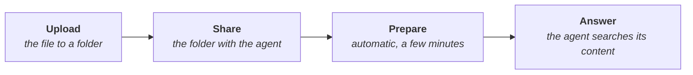

# Knowledge Hub

<PageMeta route="/knowledge-hub">the relevant one on **Knowledge Hub**</PageMeta>

The organization's document repository, organized in folders. It is the source the agents read from: an agent only answers with the content of the folders shared with it.

This section does not require any programming knowledge.

<Screenshot src="/img/en/centro-de-conocimiento/centro-de-conocimiento.png" alt="Knowledge Hub screen in ConsulPoint" caption="Knowledge Hub" />

## How a document reaches an agent {#cómo-llega-un-documento-a-un-agente}

1. **Upload** the file to a folder.
2. **Share** the folder with the agent. The order of these two steps does not matter.
3. The platform **prepares** each file so the agent can read it: it extracts the text, splits it into chunks and indexes it so it can be searched by meaning. This happens on its own and takes a few minutes.
4. During a conversation, the agent **searches** that content for the chunks related to each question and answers with them.

:::warning Uploading is not enough
A file in a folder that is not shared with any agent is stored, but no agent reads it. See [Agent knowledge](/centro-de-conocimiento/conocimiento-de-los-agentes).
:::

## The two tabs {#las-dos-pestañas}

| Tab | Content |
|---|---|
| **My documents** | The user's own folders and files |
| **Shared with me** | What other people share with the user |

**My documents** only appears for roles with edit permission on Knowledge Hub. With the default roles, users and collaborators only see **Shared with me**. Inside a [workspace](/modulos/espacios-de-trabajo) there is no **My documents** either: content arrives shared.

## Folder types {#tipos-de-carpeta}

You choose it when you create the folder, and it cannot be changed later.

| Type | What it is for |
|---|---|
| **Standard** | Any type of document. It is the usual option for giving knowledge to agents |
| **Smart Extract** | An agent extracts data from each document uploaded and stores it, for example from invoices or forms. See [Smart Extract](/centro-de-conocimiento/extraccion-inteligente) |
| **Multimedia** | YouTube videos and audio, from which the transcript is obtained. See [Multimedia](/centro-de-conocimiento/multimedia) |

## Where to start {#por-dónde-empezar}

| I want to… | Page |
|---|---|
| Create folders, search, move or delete content | [Folders and files](/centro-de-conocimiento/carpetas-y-archivos) |
| Upload documents and know which formats are supported | [Upload documents](/centro-de-conocimiento/subir-documentos) |
| Have an agent answer with my documents | [Agent knowledge](/centro-de-conocimiento/conocimiento-de-los-agentes) |
| Give access to other people or to a workspace | [Sharing and permissions](/centro-de-conocimiento/compartir-y-permisos) |
| Get data from invoices, delivery notes or forms | [Smart Extract](/centro-de-conocimiento/extraccion-inteligente) |
| Work with YouTube videos or audio | [Multimedia](/centro-de-conocimiento/multimedia) |
| Solve a problem | [Common issues](/centro-de-conocimiento/problemas-frecuentes) |

## Best practices {#buenas-prácticas}

:::tip Document organization
- One folder per topic, instead of a single folder with everything. This lets you share with each agent only what it needs.
- Start with the most consulted documentation: FAQs, catalogs, policies and manuals.
- Remove outdated documentation. An agent repeats an outdated document with the same confidence as a current one.
:::
