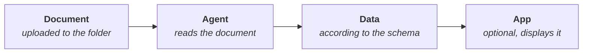

# Smart Extract

A **Smart Extract** folder pulls data from each document uploaded to it and stores it in a structured way: for example, the supplier, date and amount of each invoice. The extraction is done by an agent, following a schema that defines which data matters.

**Use cases:** invoices, delivery notes, orders, forms and any recurring documentation with a stable structure.

## Before you start {#antes-de-empezar}

At a minimum, you need an **OCR micro-agent** created in Studio: it is the agent that reads the documents. See [Micro-agents](/control/estudio/microagentes).

Optionally:

- A **data schema**, to set which data is extracted and check that it is met. See [Data schemas](/control/estudio/esquemas-de-datos).
- A viewer-type **integrated app**, to see the data with its own design. See [Integrated apps](/aplicaciones-integradas).

## Set up the folder {#configurar-la-carpeta}

1. Create a folder and choose the **Smart Extract** type (see [Create a folder](/centro-de-conocimiento/carpetas-y-archivos#crear-una-carpeta)).
2. In **Smart Extract settings**, fill in:

   | Field | Description |
   |---|---|
   | **Agent** | Required. The OCR micro-agent that extracts the data |
   | **Data schema (optional)** | Defines which data is stored from each document |
   | **App (optional)** | Shows a preview of the extracted data |

3. Click **Create folder**.

You can change the settings later with **Edit folder**. The platform asks for confirmation, because it affects documents uploaded from that point on.

These folders accept PDF, PNG and JPG images, and Markdown.

## Extraction statuses {#estados-de-la-extracción}

In list view, the **Smart Extract** column shows each document's status:

| Status | Meaning |
|---|---|
| **Pending** | Waiting for the data to be extracted |
| **Extracting data** | In progress |
| **Data extracted** | Finished |
| **Extracted with warnings** | Finished, but the data does not match the data schema |
| **Couldn't extract** | It failed. You can retry from the file preview |
| **Duplicate** | The file repeats the content of another file in the folder that was already extracted, so it was not extracted again |

When an extraction fails, hover over **Couldn't extract**, or look at the **Reason** row in the preview, to see the cause:

| Cause | What to do |
|---|---|
| The extraction agent has no instructions | Add them in its settings and retry |
| The extraction agent is not set up correctly | Check its type and model, and retry |
| The plan does not include the agent's AI model | Choose another model or upgrade the plan |
| The file is too long | Try a shorter one |
| The cause could not be identified | Retry and, if it keeps failing, contact support |

Anyone without permission to extract sees the cause along with a note to ask an administrator for help.

## View and manage the data {#ver-y-gestionar-los-datos}

When you open a file, the **Smart Extract** section shows the status, dates and result, with **View the data**. The preview also has the **Extracted data** tab and, if the folder has an app, **App view**.

| Action | What it does |
|---|---|
| **Extract data** / **Retry** | Starts the extraction if it was not done or it failed |
| **Extract again** | Extracts again and replaces the current data. Uses credits. The current note is not carried over to the new extraction |
| **Notes** | A free-text note about the extraction, up to 500 characters |
| **Delete extraction** | Deletes the extracted data. The file is not affected |

These actions require being the file's owner or having the **Can manage** level on the folder.

If the data does not match the schema, the section says so (**The data does not match the schema**) and lists the problems with **View issues**. Review them before using that data in another application.

## Best practices {#buenas-prácticas}

:::tip Reliable extractions
- One folder per document type: invoices in one, delivery notes in another. Each with its own agent and schema.
- Define a data schema. Without it, the platform cannot warn you when a piece of data is missing or has the wrong format.
- Test with a few real documents before uploading a large batch, and adjust the micro-agent's instructions if needed.
:::
