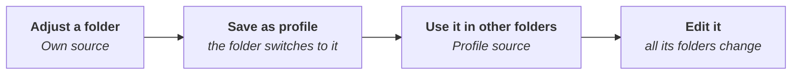

# Search profiles

<PageMeta route="/knowledge-hub">view on **Knowledge Hub** to check them; create to create them; only the person who created a profile can edit or delete it</PageMeta>

A **search profile** is a set of named [search settings](/centro-de-conocimiento/busqueda-de-los-agentes) shared by several folders: document preparation, search results and the search agent. When you edit the profile, every folder that uses it changes.

**Use cases:** a "Product records" profile for all the catalog folders; a "Regulations" profile with long passages and a search agent that knows the sector's acronyms.

## A profile's journey {#el-recorrido-de-un-perfil}

Profiles aren't created from scratch: they come from a folder that already has tested settings.

## Create a profile {#crear-un-perfil}

1. Open **Agents' search** on the folder (**⋯** menu → **Configure agents' search**).
2. Choose the **Own** source and adjust the values. It's best to test them first in Conversations.
3. Click **Save as profile**.
4. Fill in the window:

   | Field | Description |
   |---|---|
   | **Profile name** | Required, up to 100 characters. It can't be repeated in the same workspace. For example: "Technical manuals" |
   | **Description (optional)** | Up to 500 characters. What kind of folders it's for |
   | **Available in all workspaces** | If unchecked, the profile can only be used in the current workspace. See below |

5. Click **Create profile**.

<Screenshot src="/img/en/centro-de-conocimiento/perfil-guardar.png" alt="Save as profile window" caption="Save as profile" maxWidth={560} />

The folder switches to the profile: **Profile created — The folder now uses the profile "…"**. If the unsaved settings affect document preparation, the change review appears first, with **Only create the profile** or **Create and apply now**. See [Update the documents](/centro-de-conocimiento/actualizar-los-documentos#revisar-el-cambio).

**Save as profile** only appears to the person who created the folder and has create permission on the **Knowledge Hub**. If a setting has an error, the button stays disabled until you fix it.

## Use a profile on a folder {#usar-un-perfil-en-una-carpeta}

1. Open **Agents' search** on the folder.
2. Choose the **Profile** source and the profile in **Search profile**. Its values and description are shown below.
3. Click **Save changes**.

<Screenshot src="/img/en/centro-de-conocimiento/busqueda-perfil.png" alt="Agents' search window with the Profile source selected" caption="Agents' search → Profile" maxWidth={480} />

Switching to a profile changes document preparation, so the change review appears. See [Update the documents](/centro-de-conocimiento/actualizar-los-documentos).

A profile applies as a whole. To adjust a value on just one folder, **Use as own settings** copies the profile's values to the folder, which switches to **Own** and stops receiving the profile's changes.

## The Search profiles window {#la-ventana-perfiles-de-búsqueda}

<Screenshot src="/img/en/centro-de-conocimiento/perfiles-lista.png" alt="Search profiles window with the list of profiles" caption="Search profiles" maxWidth={600} />

It opens with the **Search profiles** button on the Knowledge Hub's main page, or with **Manage profiles** from a folder's search window.

Each profile shows its name, its description and:

| Indication | Means |
|---|---|
| **Yours** | You created it |
| **In all workspaces** / **Only in this workspace** | Where it can be used |
| **Used by … folders** / **No folder uses it** | How many folders use it |

Clicking a profile opens its details, with all its values. If you created it, you also see **Folders using it**, with **Open** to go to each folder's settings, and the **Edit** and **Delete** buttons.

<Screenshot src="/img/en/centro-de-conocimiento/perfil-detalle.png" alt="Details of a search profile with its values and the folders that use it" caption="A profile's details" maxWidth={480} />

## Edit a profile {#editar-un-perfil}

Only the person who created the profile can edit it.

1. In the profile's details, click **Edit**.
2. Change the name, the description, the availability in workspaces or the **Settings**, which are the same as in the **Own** settings, including the search agent.
3. Click **Save changes**.

If folders use the profile, the window reminds you before saving. When you save, **all those folders** receive the changes:

- Changes to **Search results** and to the search agent apply from the next message.
- Changes to **Document preparation** leave documents pending in each folder. They aren't applied on their own: you have to update each folder.

<Screenshot src="/img/en/centro-de-conocimiento/perfil-cambios-sin-aplicar.png" alt="Notice of folders with changes to apply after editing a profile" caption="Folders with changes to apply after editing a profile" maxWidth={480} />

After saving, the details warn **… folders have changes to apply**, with the documents to update in each one and **Open to apply**, which opens that folder's settings. See [Update the documents](/centro-de-conocimiento/actualizar-los-documentos#actualizar-los-documentos-pendientes).

:::info The notice lasts as long as the session
Only the person who edited the profile sees the list of folders with changes to apply, and only until they sign out or reload the page. The folders stay marked with pending documents in the Knowledge Hub until they're updated.
:::

## Delete a profile {#eliminar-un-perfil}

Only the person who created the profile can delete it, and only if **no folder uses it**. If any folder uses it, the platform says so (**… folder uses it. Switch it to another search option before deleting it.**): you have to move those folders to another source first.

In the profile's details, click **Delete** and confirm. This can't be undone.

## Profiles and workspaces {#perfiles-y-espacios-de-trabajo}

A profile belongs to the place where it was created: a [workspace](/modulos/espacios-de-trabajo), or the Knowledge Hub outside workspaces.

| **Available in all workspaces** | Where it can be used |
|---|---|
| Unchecked | Only in the workspace where it was created |
| Checked | In all workspaces and outside them |

- If a folder is shared outside the profile's workspace, the profile has to be available in all of them. When you create the profile from that folder, the platform checks the option and asks you to create it again.
- You can't uncheck it while a folder in another workspace uses it: the platform tells you which ones.
- A workspace can't be deleted while any folder uses one of its profiles.

## Who can do what {#quién-puede-hacer-qué}

| Action | Who |
|---|---|
| View profiles and their values | Anyone with access to the Knowledge Hub, in the workspace where the profile is available |
| Create a profile | The person who created the folder, with create permission on the **Knowledge Hub** |
| Use a profile on a folder | Anyone who can edit the folder |
| Edit or delete a profile, and see which folders use it | Only the person who created it |

## Best practices {#buenas-prácticas}

:::tip Names that say what they're for
"Product records" or "Technical manuals" say more than "Profile 1". The description helps whoever chooses the profile for a new folder.
:::

:::tip Test before turning it into a profile
A profile is applied to all its folders. Test the settings on one folder, with real questions, before saving them as a profile.
:::
