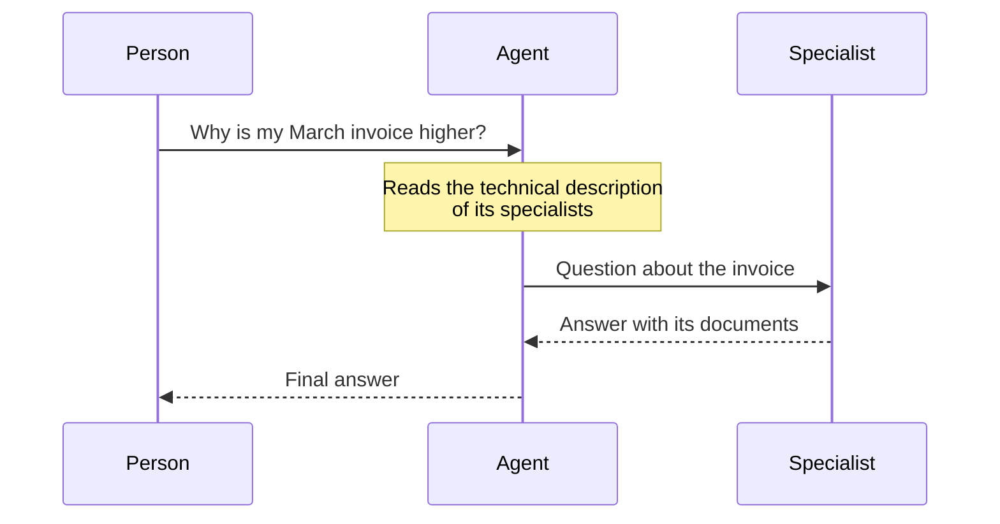

# Specialists

A **specialist** is an agent that is an expert on a specific topic, which an [agent](/control/estudio/agentes) consults during a conversation. It doesn't talk with people: the agent passes it the question, the specialist answers the agent, and the agent puts together the final answer.

**Use cases:** a sales assistant that consults a billing specialist; a support assistant that consults one specialist for each product line.

## How the agent uses it {#cómo-lo-usa-el-agente}



1. The agent receives the question.
2. It reads the **Technical description** of each assigned specialist and decides whether one of them fits.
3. If so, it passes the question on. The specialist answers using its instructions and its documents.
4. The agent uses that answer to reply to the person.

The agent can answer without consulting any specialist, or consult several in the same answer.

### What a specialist can do {#qué-puede-hacer-un-especialista}

- Answer using its **system instructions** and its **documents**, its own or from Knowledge Hub folders shared with it.
- It can only have the **Knowledge hub access** built-in function: it doesn't search the web or use connectors.
- It can't consult other specialists. There's only one level: agent → specialist.

## Create a specialist {#crear-un-especialista}

In the Studio, on the **Specialists** tab, click **New specialist**. The form is the one in [Create an agent](/control/estudio/crear-un-agente), with these differences:

| | Specialist |
|---|---|
| **Technical information** | Two more required fields (see below) |
| **Image** | None |
| **Personalization** (tone and starters) | None |
| **Built-in functions** | Only **Knowledge hub access** |
| **Access** | **Only me** or **My organization** |

| Field | Description |
|---|---|
| **Technical name** | Internal identifier. Up to 20 characters: letters, numbers and underscores. It can't start or end with a number. Example: `customer_billing` |
| **Technical description** | Up to 10,000 characters. It's what the agent reads to decide **when** to consult it |

:::warning The technical description decides whether it's used
It isn't a description for people: it's the agent's criterion. It must say precisely in which cases the specialist should be consulted and in which it shouldn't. If it's vague, the agent won't consult it when it should, or will consult it when it shouldn't.
:::

Example of a technical description:

```prompt
Consult this specialist when the person asks about invoices: amounts, line items, payment dates, duplicates or differences between months. Don't consult it for prices of new products or for technical issues.
```

## Assign specialists to an agent {#asignar-especialistas-a-un-agente}

1. Open the agent's detail.
2. **Specialists** tab → **Assign specialist**.
3. Choose one or more and confirm.

You can also do this from the agents list: each row expands to show its specialists, with the **Assign specialist** button.

To remove one, use **Disconnect** on the same tab. The specialist isn't deleted; it just stops being available to that agent.

Assigning and disconnecting requires being able to edit the agent. The same specialist can be assigned to several agents.

## Best practices {#buenas-prácticas}

:::tip Useful specialists
- One specialist per well-defined topic, with its own documents.
- Few words in common between the technical descriptions of the specialists of the same agent, so they don't compete.
- Test in Conversations with questions that **should** reach the specialist and others that **shouldn't**. Above the answer, [What the agent did](/conversaciones/conversar-con-un-agente#qué-hizo-el-agente) shows **Consulted "…"** when it consulted it.
:::
