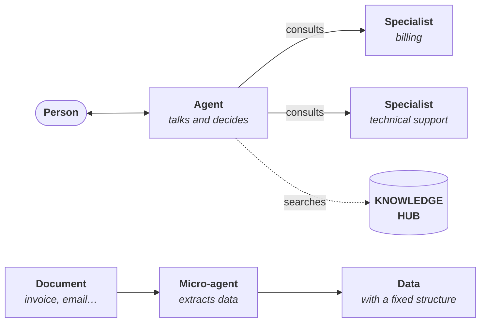

# Studio

<PageMeta route="/studio">the relevant one on **Studio**</PageMeta>

The Studio is where your organization's agents are created and set up: what they do, how they answer, which AI model they use, which documents they look up and who can use them.

This section doesn't require any programming knowledge.

<Screenshot src="/img/en/estudio/estudio.png" alt="Studio screen in ConsulPoint" caption="Studio" />

## The three agent types {#los-tres-tipos-de-agente}

| | Agent | Specialist | Micro-agent |
|---|---|---|---|
| **What it is** | An autonomous agent that talks with people | An agent that is an expert on a topic, which an agent consults | An agent that does one specific task and returns data with a fixed structure |
| **Who it talks to** | People, in Conversations or in a channel such as WhatsApp | Only the agent that consults it | Nobody: the platform runs it |
| **Where it's used** | Conversations, connected channels, API | Inside an agent | Knowledge Hub, Smart Inbox and conversation analysis |
| **Example** | Customer service assistant | Billing specialist | Invoice reader that extracts the supplier, date and amount |
| **Learn more** | [Agents](/control/estudio/agentes) | [Specialists](/control/estudio/especialistas) | [Micro-agents](/control/estudio/microagentes) |

You choose the type when you create the agent, and you can't change it later.

## The tabs {#las-pestañas}

| Tab | Contents |
|---|---|
| **Agents** | Your organization's agents |
| **Specialists** | The specialists available to assign to agents |
| **Micro-agents** | The micro-agents, with their type and schema |
| **Skills** | Reusable procedures you assign to agents and specialists. See [Skills](/control/estudio/habilidades) |
| **Schema library** | Data structures that micro-agents, folders and apps can reuse. It only appears if you have permission on the library |

On each tab, the button in the corner creates an item of that type (**New agent**, **New specialist**, **New micro-agent** or **New schema**). You can filter the lists by name and by model; the micro-agents list, by type as well.

## The full path {#el-recorrido-completo}

To get an agent up and running that answers with your organization's documents:

1. **Prepare the knowledge.** Upload the documents to folders in the [Knowledge Hub](/modulos/centro-de-conocimiento).
2. **Create the agent** in the Studio, with its instructions, its model and the **Knowledge hub access** built-in function. See [Create an agent](/control/estudio/crear-un-agente).
3. **Give it access to the folders.** Share them with the agent. See [Agents' knowledge](/centro-de-conocimiento/conocimiento-de-los-agentes).
4. **Assign it specialists**, if some topics are better kept separate, and **skills**, if it has to follow specific procedures. See [Specialists](/control/estudio/especialistas) and [Skills](/control/estudio/habilidades).
5. **Decide who uses it**: only the person who creates it, the whole organization, or specific people and roles.
6. **Test it** in [Conversations](/modulos/conversaciones) and check the sources of each answer.
7. **Connect it to a channel**, if it will serve people outside the platform. See [Integrations and channels](/modulos/integraciones).

## Who can do what {#quién-puede-hacer-qué}

With the default roles:

| Role | In the Studio |
|---|---|
| Administrator | Everything |
| User | Create, view and edit agents. Not delete them |
| Collaborator | View only |

In addition, each agent has its own [access](/control/estudio/agentes#acceso): a user only sees and edits the agents they have access to. The **Schema library** and the agents' **Connectors** are, by default, for administrators only.

The number of agents you can create depends on your plan. Without an active plan, the create buttons appear disabled.

## Where to start {#por-dónde-empezar}

| I want to… | Page |
|---|---|
| Create my first agent | [Create an agent](/control/estudio/crear-un-agente) |
| Manage an existing agent: documents, access, deleting it | [Agents](/control/estudio/agentes) |
| Have an agent hand certain topics to a more expert one | [Specialists](/control/estudio/especialistas) |
| Extract data from documents or emails | [Micro-agents](/control/estudio/microagentes) |
| Give several agents the same procedure | [Skills](/control/estudio/habilidades) |
| Define the structure of the data that gets extracted | [Schema library](/control/estudio/esquemas-de-datos) |
| Solve a problem | [Common issues](/control/estudio/problemas-frecuentes) |
