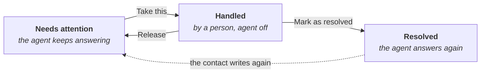

# Channels and human support

When an agent is connected to a channel (a WhatsApp number, a Telegram bot or an external app), conversations with contacts appear in Conversations. The agent answers on its own, and a person on the team can take control at any time.

To connect a channel, see [Integrations and channels](/modulos/integraciones).

## Who sees a channel's conversations {#quién-ve-las-conversaciones-de-un-canal}

The integration's owner and its team, set up in the integration, see them. If the team changes, who sees the conversations changes too.

In the header, the title is the contact's name, and below it you see the channel and the agent that answers. In a [Telegram group](#grupos-de-telegram), the title is the group's name.

## Taking control {#tomar-el-control}

In channel conversations, who is answering is shown above the message box:

| Status | Meaning | Button |
|---|---|---|
| **… is responding automatically** | The agent answers on its own | **Take control** |
| **Manual mode: you're responding directly to the channel** | What you write reaches the contact as is, without the agent | **Activate agent** |

The agent icon, next to the message box, does the same. Anyone taking part in the conversation can use it. While the agent is off, the header shows **Agent disabled**.

## Human support {#atención-humana}

A conversation is marked **Needs attention** when the agent detects that a person is needed: the contact asks to talk to someone, gets frustrated or the agent cannot help them. Also when the agent fails to answer.

| Action | What it does |
|---|---|
| **Take this** | The person takes over and the agent stops answering. Writing in a conversation that needs attention also takes it |
| **Release** | Returns the conversation to **Needs attention** so someone else can handle it. The agent stays off |
| **Mark as resolved** | Closes the support and the agent answers again |
| **Remove attention flag** | In **More options**. Removes the mark if it was not needed |

While a person is handling a conversation, the rest of the team sees **Handled by…** and cannot write in it.

### Notices to the team {#avisos-al-equipo}

- When a conversation is marked, the integration's team gets a notice.
- If nobody takes it within a while (30 minutes by default), the team gets another notice, also by email.

### Messages to the contact while waiting {#mensajes-al-contacto-mientras-espera}

While nobody is handling it, the contact gets an initial message, periodic reminders and, if the wait runs out, a notice that nobody is available. The texts and times are set up in each integration.

## Starting a conversation on WhatsApp or Telegram {#iniciar-una-conversación-por-whatsapp-o-telegram}

From **New conversation** you can also write to a contact first:

| Channel | What you need |
|---|---|
| **WhatsApp** | **WhatsApp connection**, **Phone number**, **Contact name (optional)** and an **Approved template**, with its variables. WhatsApp only allows starting conversations with approved templates |
| **Telegram** | An **Existing contact** or their **Telegram chat ID**, and the **Message** |

Each option only appears with permission on the integrations and with at least one active connection for that channel (on WhatsApp, also not expired). You can only choose active connections.

Some WhatsApp templates can't be sent from the platform yet and show as **Can't be sent from here yet**: those with an image, a video, a document or a location in the header, variables in the header, or buttons that carry their own data (copy a code, a verification code, a catalog or a link with a variable). You can use the ones with only text, variables in the body and fixed buttons.

## Contacts {#contactos}

When a conversation comes in from someone who isn't linked to any contact, the platform looks for a similar one. If it finds one, the conversation shows **Is this …?**, with the detail that matches, and the buttons **Yes, that is them** or **Not now**.

In **More options**, **Assign contact** links the conversation to a contact in your directory, and **Remove assigned contact** unlinks it.

| Action | What you need |
|---|---|
| See the **Is this …?** suggestion | Permission to view and create in **Contacts** |
| **Assign contact** | Permission to create in **Contacts** |
| **Remove assigned contact** | Permission to delete in **Contacts** |

In every case, the subscription has to include Contacts. In Telegram groups, no contact is suggested or assigned.

## Telegram groups {#grupos-de-telegram}

A connected Telegram bot can also be added to a group. Each group is a single conversation in the platform:

- In the list, on Home and in the header it shows with the group's name and the **Group** badge. If the group has no name, it shows **Telegram group**.
- The agent answers the group messages the bot receives. By default, Telegram only delivers the messages that mention the bot or reply to it; for it to receive all of them, turn off the bot's privacy mode in @BotFather or make it an administrator of the group.
- A group isn't linked to a contact, because several people write in it. In **Conversation Details**, the **Group name** appears under **Conversation Information**. If the group was linked to a contact before, it shows as **Assigned contact** and you can remove it with **Remove assigned contact**.
- The agent doesn't keep [memory](/control/estudio/memoria) of a group.

## Contact memory {#memoria-del-contacto}

If the agent has [memory](/control/estudio/memoria), it remembers what matters about each WhatsApp, Telegram or external app contact: their name, language, previous requests and what's pending. It uses it every time the contact writes to it.

Administrators can check it from the conversation: in **More options**, **Agent memory**, or in **Conversation details**, **See what it remembers**. The **What it remembers about this contact** window shows the text and the date of the last update.

**Delete memory** makes the agent forget everything it saved about the contact and start from scratch in their next conversation. It can't be undone. A contact's memory can't be edited.

The agent only uses and updates memory when answering the contact, not with the team's messages.
