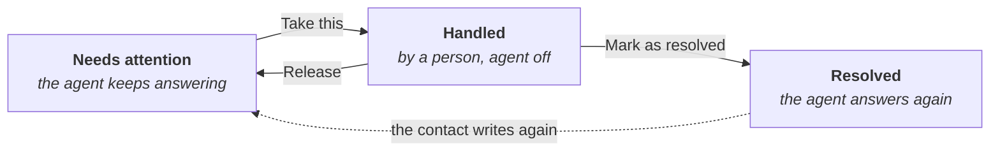

# Channels and human support

When an agent is connected to a channel (a WhatsApp number, a Telegram bot or an external app), conversations with contacts appear in Conversations. The agent answers on its own, and a person on the team can take control at any time.

To connect a channel, see [Integrations and channels](/modulos/integraciones).

## Who sees a channel's conversations {#quién-ve-las-conversaciones-de-un-canal}

The integration's owner and its team, set up in the integration, see them. If the team changes, who sees the conversations changes too.

In the header, the title is the contact's name, and below it you see the channel and the agent that answers.

## Taking control {#tomar-el-control}

In channel conversations, who is answering is shown above the message box:

| Status | Meaning | Button |
|---|---|---|
| **… is responding automatically** | The agent answers on its own | **Take control** |
| **Manual mode: you're responding directly to the channel** | What you write reaches the contact as is, without the agent | **Activate agent** |

The conversation's owner can also turn the agent on or off in **More options** → **Agent responses**.

## Human support {#atención-humana}

A conversation is marked **Needs attention** when the agent detects that a person is needed: the contact asks to talk to someone, gets frustrated or the agent cannot help them. Also when the agent fails to answer.

| Action | What it does |
|---|---|
| **Take this** | The person takes over and the agent stops answering. Writing in a conversation that needs attention also takes it |
| **Release** | Returns the conversation to **Needs attention** so someone else can handle it. The agent stays off |
| **Mark as resolved** | Closes the support and the agent answers again |
| **Remove attention flag** | In **More options**. Removes the mark if it was not needed |

While a person is handling a conversation, the rest of the team sees **Handled by…** and cannot write in it.

### Notices to the team {#avisos-al-equipo}

- When a conversation is marked, the integration's team gets a notice.
- If nobody takes it within a while (30 minutes by default), the team gets another notice, also by email.

### Messages to the contact while waiting {#mensajes-al-contacto-mientras-espera}

While nobody is handling it, the contact gets an initial message, periodic reminders and, if the wait runs out, a notice that nobody is available. The texts and times are set up in each integration.

## Starting a conversation on WhatsApp or Telegram {#iniciar-una-conversación-por-whatsapp-o-telegram}

From **New conversation** you can also write to a contact first:

| Channel | What you need |
|---|---|
| **WhatsApp** | **WhatsApp connection**, **Phone number**, **Contact name (optional)** and an **Approved template**, with its variables. WhatsApp only allows starting conversations with approved templates |
| **Telegram** | An **Existing contact** or their **Telegram chat ID**, and the **Message** |

These options only appear with permission on the integrations.

## Contacts {#contactos}

In **More options**, **Assign contact** links the conversation to a contact in your directory, and **Remove assigned contact** unlinks it.
