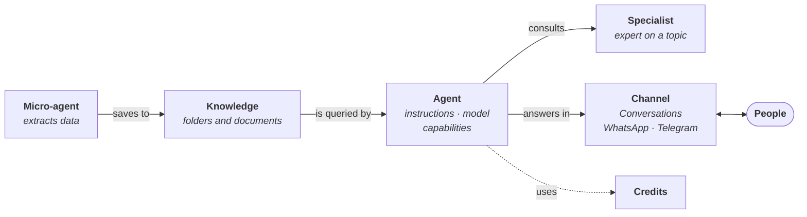

# Core concepts

<PageHero eyebrow="Introduction" highlights={['Agents', 'Knowledge', 'Channels', 'Credits']}>
  The terms used throughout the platform and this documentation, and how they fit together.
</PageHero>

## How it all fits together {#cómo-encaja-todo}

Everything happens inside an **organization**, and can be split into **workspaces**.

An organization keeps its **knowledge** in folders. An **agent** consults it to answer **people** through a **channel**, and can rely on **specialists**. **Micro-agents** work without conversing: they read documents or emails and extract their data. All AI usage consumes **credits**.

## Organization {#organización}

<ModuleGrid>
  <ModuleCard icon="organization" title="Organization">
    The entity that subscribes to ConsulPoint: the company or institution. All its data (documents, agents, users, conversations) belongs to it and is isolated from other organizations.
  </ModuleCard>
  <ModuleCard icon="workspaces" title="Workspace" href="/modulos/espacios-de-trabajo">
    An internal division of the organization, by team, department, project or client, with its own members, agents and content.
  </ModuleCard>
  <ModuleCard icon="user" title="Role" href="/organizacion/roles">
    Defines what each person can do in each module: view, create, edit or delete.
  </ModuleCard>
</ModuleGrid>

## Agents {#agentes}

<ModuleGrid>
  <ModuleCard icon="agent" title="Agent" href="/control/estudio/agentes">
    AI assistant that talks to people, in the platform or in a connected channel.
  </ModuleCard>
  <ModuleCard icon="specialist" title="Specialist" href="/control/estudio/especialistas">
    Agent that is an expert on a topic and that another agent consults during a conversation. It does not talk to people.
  </ModuleCard>
  <ModuleCard icon="microagent" title="Micro-agent" href="/control/estudio/microagentes">
    Agent that does one specific task, such as reading an invoice, and returns the data in a fixed structure. It does not converse.
  </ModuleCard>
  <ModuleCard icon="instructions" title="System instructions" href="/control/estudio/crear-un-agente#comportamiento-instrucciones-del-sistema">
    The text that defines an agent's role, its limits and how it answers. It is what most affects the quality of its answers.
  </ModuleCard>
  <ModuleCard icon="capability" title="Built-in functions" href="/control/estudio/agentes#capacidades">
    Optional functions turned on for each agent: searching the Knowledge Hub, searching the web, attaching files, voice…
  </ModuleCard>
  <ModuleCard icon="model" title="Model">
    The AI engine each agent runs on: from Google, OpenAI or Anthropic, or the organization's own model if the plan includes it.
  </ModuleCard>
</ModuleGrid>

:::warning The type is permanent
Agent, specialist or micro-agent: the type is chosen when it is created and cannot be changed later.
:::

## Knowledge {#conocimiento}

<ModuleGrid>
  <ModuleCard icon="knowledge" title="Knowledge Hub" href="/modulos/centro-de-conocimiento">
    The organization's document repository, which agents read from.
  </ModuleCard>
  <ModuleCard icon="folder" title="Folder" href="/centro-de-conocimiento/carpetas-y-archivos">
    The unit used to organize and share knowledge. An agent reads the folders shared with it.
  </ModuleCard>
  <ModuleCard icon="schema" title="Data schema" href="/control/estudio/esquemas-de-datos">
    The structure that defines which data is extracted from a document and in what shape.
  </ModuleCard>
</ModuleGrid>

## Channels and applications {#canales-y-aplicaciones}

<ModuleGrid>
  <ModuleCard icon="integration" title="Integration" href="/modulos/integraciones">
    A connection to an external channel (WhatsApp, Telegram, an email account) or to another system.
  </ModuleCard>
  <ModuleCard icon="chat" title="Conversation" href="/modulos/conversaciones">
    An exchange of messages with an agent, in the platform or in a channel.
  </ModuleCard>
  <ModuleCard icon="apps" title="Integrated app" href="/aplicaciones-integradas/como-funcionan">
    An application with its own interface that is shown inside ConsulPoint and works with the organization's data.
  </ModuleCard>
</ModuleGrid>

## Usage {#consumo}

<ModuleGrid>
  <ModuleCard icon="credits" title="Credits" href="/organizacion/creditos-y-limites">
    The balance the organization uses to pay for AI usage. Every answer, analysis or web search consumes them. Answers from the organization's own models do not consume credits.
  </ModuleCard>
  <ModuleCard icon="token" title="Token">
    The unit models use to measure text: what is sent to them (input) and what they generate (output). The tokens used are charged in credits.
  </ModuleCard>
</ModuleGrid>

:::info If credits run out
After a short grace period, agents stop answering and analyses stop until credits are topped up.
:::
