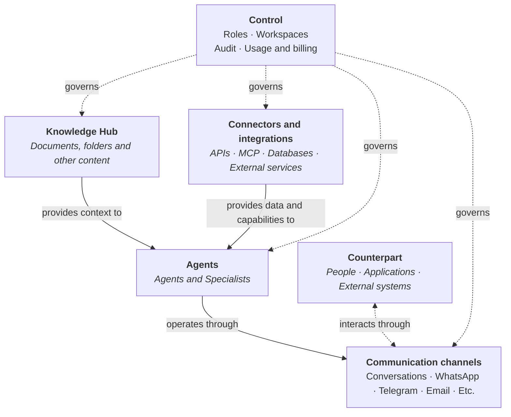
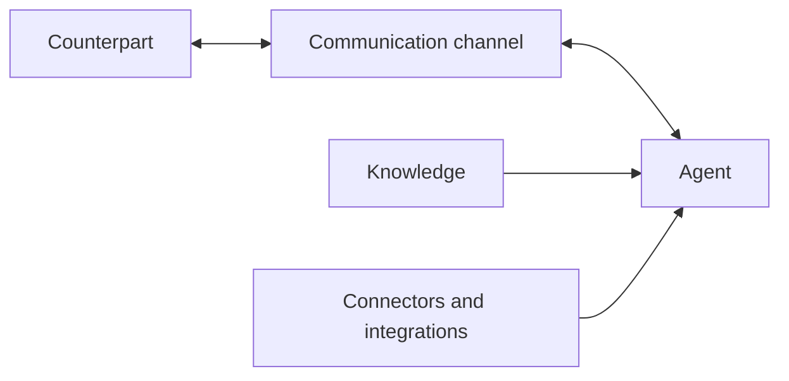

**ConsulPoint is a next-generation enterprise productivity platform, designed with artificial intelligence at its core**. It brings together knowledge, agents, communications and applications in a governed environment to meet the daily needs of employees and operators.

It connects to the systems the organization already uses through connectors and APIs, and makes it possible to add agile, purpose-built applications that make use of their data and functions. These tools can complement existing processes and gradually replace certain features when it makes sense, at each organization's own pace.

Its architecture is modular. Each capability can be used on its own, but the most value comes when **knowledge, agents, communication channels, integrated apps, connectors and integrations** work together under the same model of permissions, traceability, supervision and control.

## Functional architecture {#arquitectura-funcional}

ConsulPoint is organized into several functional elements that work in coordination. The control layer acts across the rest of the platform.



**Knowledge** gives agents information specific to the organization.

**Agents** use that knowledge, together with their instructions and capabilities, to answer, reason or carry out tasks.

**Connectors and integrations** let agents look up information and take actions on external systems, such as business applications, databases, web services or third-party tools, through mechanisms such as APIs or MCP.

**Communication channels** are the means through which agents interact with people, applications or external systems.

The **counterpart** is the person, application or system that starts an interaction with ConsulPoint or receives its result.

The **control layer** defines how each resource is accessed and used, through roles, workspaces, auditing and usage control.

An agent can work without linked knowledge or without external integrations. In that case, it works only with its instructions and the capabilities available in the configured model.

As a general rule, this is the recommended outline for setting up a new use case:



The **control layer** acts across every element of the system.

## What it can do {#qué-permite-hacer}

ConsulPoint makes it possible to build and run artificial intelligence use cases on an organization's real knowledge, systems and channels.

Among other things, the platform makes it possible to:

- create internal and external assistants backed by the organization's own information;
- handle requests through channels such as conversations, WhatsApp, Telegram, email or other integrated means;
- connect agents to applications, databases and external services through APIs, MCP and other integration mechanisms;
- look up information in corporate systems and use it during a conversation or process;
- take actions on external tools when the agent has the necessary capabilities and permissions;
- create specialized agents for specific areas, processes or functions;
- analyze messages, documents and other content to classify information, extract data or generate answers;
- combine knowledge, agents, connectors and channels within the same use case;
- keep supervision, traceability and control over the use of artificial intelligence within the organization.

ConsulPoint is not limited to a single type of assistant or channel. Its components can be combined to fit internal processes, customer service, operations management, information lookup or interaction with corporate systems.

## Security and data isolation {#seguridad-y-aislamiento-de-datos}

The **organization** is the main scope of isolation, administration and control in ConsulPoint.

Every resource created or managed in the platform belongs to a specific organization. This includes, among others:

- users;
- documents and knowledge;
- agents and specialists;
- conversations;
- integrated apps;
- connectors and integrations;
- settings;
- workspaces;
- audit records.

An organization's resources are not part of any other organization's environment.

Within the same organization, access to information and capabilities is further restricted by roles, workspaces and the access granted to each resource. A person can do something only if all three conditions are met:

```text
Effective access = User's role ∩ Access to the resource (folder, agent, conversation…) ∩ Workspace
```

For example, for someone to edit a Knowledge Hub folder, their role must allow editing in that module, the folder must be theirs or shared with them with edit permission, and they must be working in the workspace it belongs to.

For organizations with stricter control requirements, additional options are available on request.
